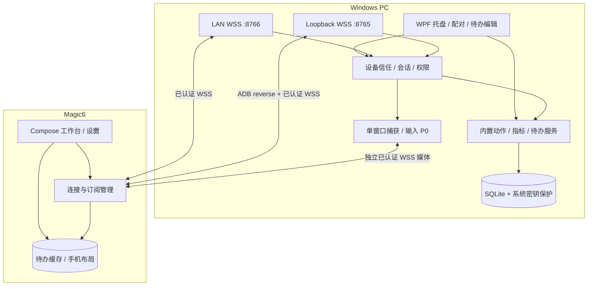
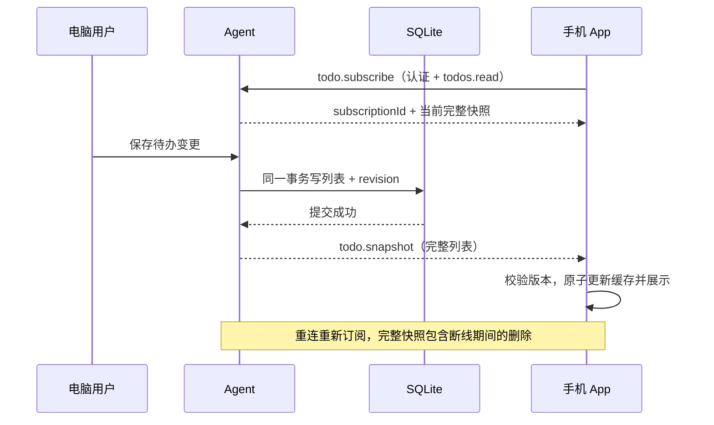

<!-- source: README.md -->

# SupperScreen 项目文档总入口

> v0.22 开发验收版，2026-11-13。连接流程和验收范围见 [验证记录](VALIDATION.md)。

## 1. 项目定位

将荣耀 Magic6（MagicOS 10、无 SIM 卡）作为一台 Windows 电脑的桌面控制与待办展示终端。Windows Agent 提供安全连接、基础指标、快捷操作和待办编辑；Android App 展示工作台和电脑维护的待办列表。

核心功能离线可用，不依赖手机号、账号或公网。电脑保持原以太网/Wi-Fi 连接；USB ADB、局域网与蓝牙共用一个可信设备身份。当前支持一台电脑与一台手机。

## 2. 功能范围与阶段

- Windows 托盘运行、二维码配对、电脑确认、身份保存与撤销。
- 同一手机解除配对后可凭新二维码重新配对。手机端固定左右横屏，应用可见时屏幕常亮。
- 手机端沉浸式全屏。蓝牙与有线连接共用 SupperScreen 配对流程，蓝牙工作台同步电脑待办和性能，并支持授权后的终端与快捷脚本。
- 两端通过系统设置加入网络。电脑自动识别局域网地址，手机自动发现，并在 USB、局域网和蓝牙之间重连。
- CPU、内存、各盘已用与总量、磁盘 I/O 和网络吞吐。蓝牙、USB 或局域网下显示「应用」与「音量」，可启动允许的程序并调节电脑音量和媒体。
- Windows 新增时设置文字色和背景色，支持编辑、排序、标记完成和删除待办，手机获授权后可标记完成。
- 电脑保存待办并向手机推送快照。断连时手机显示缓存及最后同步时间。
- 横屏工作台左侧待办独立滚动。顶部依次为电脑名、主页、PowerShell、性能、音量、应用、脚本、截屏、连接状态和设置。性能、音量、应用和脚本在右侧切换。
- 手机点 PowerShell 直接打开终端，权限在电脑「手机与权限」管理。快捷截屏在电脑按显示器保存 PNG。
- 桌面端请求管理员权限。脚本支持 .ps1 和 .cmd，执行状态和日志显示在同一条目。电脑可以单独开放锁屏音量和指定脚本。
- Windows 全局快捷键直接打开置顶待办悬浮窗，支持查看、完成和回车添加。
- 受控任务、待办误删撤销和基础媒体控制已实现。0.21 起移除手机触发的预设组合键。

0.12 起移除桌面窗口视频和远程窗口输入。0.20 起移除 CLI 配置与选择，保留 PowerShell。早期章节保留历史设计，包括旧热点管理方案。当前功能和协议以 [实现协议](PROTOCOL-IMPLEMENTED.md) 为准。

移除清单见 [PRD](docs/01-产品需求PRD.md)，所列能力不再作为后续版本承诺。

## 3. 推荐阅读顺序

[范围](docs/00-项目范围与约束.md) → [PRD](docs/01-产品需求PRD.md) → [SRS](docs/02-软件需求SRS.md) → [架构](docs/04-总体技术架构.md) → [待办](docs/11-待办事项功能设计.md) → [计划](docs/18-迭代计划与里程碑.md) / [验收](docs/17-测试计划与验收.md)。

## 4. 文档目录

| 编号 | 文档 | 作用 |
|---|---|---|
| 00 | [项目范围与约束](docs/00-项目范围与约束.md) | 单电脑、离线与边界 |
| 01 | [产品需求 PRD](docs/01-产品需求PRD.md) | 当前功能与移除清单 |
| 02 | [软件需求 SRS](docs/02-软件需求SRS.md) | 可测试的需求编号 |
| 03 | [典型场景与用例](docs/03-典型场景与用例.md) | 连接、控制与待办流程 |
| 04 | [总体技术架构](docs/04-总体技术架构.md) | 双端职责与数据流 |
| 05 | [USB/Wi-Fi 通信](docs/05-USB-WiFi通信设计.md) | 早期链路设计、切换与去重 |
| 06 | [二维码配对与设备发现](docs/06-二维码配对与设备发现.md) | 信任建立和重连 |
| 07 | [接口与消息协议](docs/07-接口与消息协议.md) | 命令、事件与待办快照 |
| 08 | [安全与权限](docs/08-安全与权限设计.md) | 身份、授权与待办隐私 |
| 09 | [Windows 端设计](docs/09-Windows端详细设计.md) | 托盘、指标、控制与待办编辑 |
| 10 | [Android 端设计](docs/10-Android端详细设计.md) | 扫码、工作台与待办缓存 |
| 11 | [待办事项功能设计](docs/11-待办事项功能设计.md) | 初版设计，现行手机操作为标记完成 |
| 12 | [单应用窗口远程交互](docs/12-单应用窗口远程交互.md) | 历史设计，0.12 已移除 |
| 14 | [UI 与交互设计](docs/14-UI交互与信息架构.md) | 页面和状态 |
| 15 | [本地数据模型](docs/15-数据模型与配置.md) | 存储与数据归属 |
| 16 | [性能可靠性与日志](docs/16-性能可靠性与日志.md) | 指标、恢复与诊断 |
| 17 | [测试与验收](docs/17-测试计划与验收.md) | 功能、安全、待办与非功能测试 |
| 18 | [迭代计划](docs/18-迭代计划与里程碑.md) | 当前版本与待验证项目 |
| 19 | [构建部署与故障排查](docs/19-构建部署与故障排查.md) | 工程骨架与排障 |
| 20 | [架构决策 ADR](docs/20-架构决策记录ADR.md) | 当前决定与待定项 |
| 21 | [风险与待验证事项](docs/21-风险与待验证事项.md) | 实机与同步风险 |
| 22 | [开发 Backlog](docs/22-开发任务Backlog.md) | 可执行任务清单 |
| 23 | [需求追踪矩阵](docs/23-需求追踪矩阵.md) | 功能及非功能追踪 |
| 24 | [官方资料与参考](docs/24-官方资料与参考.md) | 当前范围的参考入口 |

编号保留历史空缺，避免大范围重编号。分篇是编辑源；ALL-IN-ONE.md、manifest.json 和 Markdown-Docs-v0.22.zip 按当前分篇生成。archive/ 下的旧版 ZIP 仅作历史留存，不属于当前需求。

> 查看 [最终确认](CONFIRMED-2026-11-10.md)、[实现协议](PROTOCOL-IMPLEMENTED.md)、[验收记录](VALIDATION.md) 及 [运行说明](../README.md)。性能目标仍需实测；不把编译通过视为真机验收通过。

已确认采纳的实现参考见文档 04、09、10、11、20 与 [资料入口](docs/24-官方资料与参考.md)：USB 连接管理、统一动作权限、手机状态模型和待办快照/缓存。现行范围与各链路能力见 [产品需求](docs/01-产品需求PRD.md)。实机通过项和待测项见 [验收记录](VALIDATION.md)。

---

<!-- source: CONFIRMED-2026-11-10.md -->

# 开发前最终确认

本记录保留 2026-11-10 的历史确认内容。后续已移除单窗口视频与远程输入，保留允许列表和一键启动 Windows 程序。现行范围见 [产品需求](docs/01-产品需求PRD.md)。

1. 单应用窗口查看与控制为首版必需，首个实际目标为 ChatGPT 类程序。
2. 不要求与电脑同时独立操作其他程序，使用同一桌面焦点。
3. 应用允许列表由电脑配置。优先复用已经打开的窗口；无窗口时可启动并等待窗口出现，多窗口由手机明确选择。
4. 弹窗按可验证归属列出，优先提示切换当前应用的模态窗体；不能确认归属时暂停，不捕获桌面兜底。
5. 实时打字：提交字符立即发送，输入法预编辑只在手机显示，确认后发送；支持删除、换行等键操作。
6. 不传输程序音频；仅文字和按钮操作，不以视频/游戏高帧率为目标。
7. 电脑保持当前用户登录与唤醒，锁屏/休眠暂停远控，手机保留待办缓存。
8. 手机默认横屏布局，同时适应系统旋转。
9. 不开发用户备份/恢复功能；本地持久化、必要数据库迁移和保存失败保护仍保留。
10. 完成开发及必要验证后关闭电脑；存在未完成工作或阻塞时不能以关机代替完成。

各版本的真机验证结果见 [验收记录](VALIDATION.md)。

---

<!-- source: PROTOCOL-IMPLEMENTED.md -->

# 当前实现协议与配置

## PowerShell 与快捷脚本

终端独立要求 `terminal.control`，默认不授予，电脑在「手机与权限」配置。USB、LAN 和 Bluetooth 使用相同认证及权限检查。蓝牙支持 task.templates/run/status.get/cancel、request.status 及 terminal.*，可推送 task.updated 和 control.paused。0.19 起，蓝牙也支持桌面应用列表、图标、启动、音量、静音与媒体指令。服务端在 session.hello 返回 apps、audio 和 media 能力，并可推送 app.catalog.changed 和 audio.state。

| action | payload / result |
|---|---|
| terminal.open | columns 20～300、rows 5～120；返回 id、shell、running、inputSequence。当前设备重复打开且进程仍运行时复用会话。旧请求中非空 profileId 会收到 UNSUPPORTED_ACTION。 |
| terminal.read | id、offset 非负字节偏移；返回 offset、data（Base64 UTF-8 VT 字节）、reset、running。每块最多 12 KiB。 |
| terminal.write | id、sequence 正整数、text 最多 8192 UTF-16 单元。会话内连续序号去重，重复序号不再次输入，跳号拒绝。 |
| terminal.resize | id、columns、rows，范围同 open。 |
| terminal.close | 结束该设备的终端进程。 |

Windows 通过 ConPTY 启动 PowerShell 7（标准安装目录存在时）或系统 Windows PowerShell 5.1，参数 -NoLogo -NoProfile，用户目录作为工作目录。手机本地离线打包 xterm.js 5.5.0 / addon-fit 0.10.0，以 Windows Terminal 默认配色呈现 VT。WebView 禁止网络、文件和内容访问及外部导航，桥接仅提供终端输入和尺寸。依赖许可证随 APK 打包，来源及摘要见 assets/terminal/DEPENDENCIES.json。

读偏移对应终端字节流，响应 offset 是下一次读偏移。手机按顺序读取并交给 xterm 的流式 UTF-8 解析器。电脑保留最近 256 KiB；偏移已被淘汰时 reset=true，从保留尾部开始并清屏。输入不写持久化去重表，输入结果不明时停止发送并提示重开，避免自动重复命令。关闭终端、撤权、解除配对、暂停控制、最后一条认证链路断开及服务退出均结束终端。后台暂停读输出，连接仍在时保留进程。

快捷脚本复用 TaskTemplate / TaskRunner 和 tasks.read/run 权限。电脑添加 .ps1 文件后生成固定 PowerShell 命令及工作目录，通过固定 -Command 设置 UTF-8 输出并调用经单引号转义的本机脚本路径。默认无手机参数，不修改执行策略。固定 CMD 脚本保存 batchFile，在其工作目录中由 cmd.exe 执行，捕获退出码和 UTF-8 标准输出及错误输出。高级参数模板保持已有规则；任务日志按现有有界结果保存，不写诊断。

本文件描述当前代码实际使用的协议。早期设计中不同的字段名以本文件和 `Models.cs` / `AgentServer.cs` 为准，protocolVersion 为 1。

## 连接与认证

- USB：`wss://127.0.0.1:8765/ws`，通过 ADB reverse 到电脑回环端点。
- LAN：`wss://本机地址:8766/ws`，启用局域网后自动监听可用 WLAN 或以太网的私有 IPv4 地址。电脑将地址加入证书和配对码。
- `/health` 只返回服务名和协议版本，不接受控制。
- 发现类型 `_mcompanion._tcp.`，TXT 含 `hostId` 和 `v=1`。各接口独立发布服务。发现不建立信任。
- QR 的 `type` 为 `magic-companion-pair`，包含 `hostId`、`hostName`、`fingerprint`、`pairSessionId`、32 字节随机 `secret`（Base64）、`expiresAt` 和 `candidates:[{transport,url}]`。
- 电脑证书 SPKI 的 SHA-256 使用 Base64URL、无 padding，前缀 `sha256:`。Android 同时检查固定公钥指纹、证书有效期和默认主机名验证。

服务端先发送 `type:challenge`、`protocolVersion:1`、`hostId`、随机 `linkId` 和 `nonce`。签名原文严格为 UTF-8：

```text
1\n{hostId}\n{linkId}\n{nonce}\n{deviceId}
```

`deviceId` 为设备 SPKI SHA-256 的小写十六进制。客户端回 `type:authenticate`、`deviceId`、`publicKey`（SPKI Base64）、`signature`（ECDSA P-256 / SHA-256，DER Base64）、`deviceName`。首次配对另带 `pairSessionId` 和 `pairProof`（以 QR secret 对上述原文做 HMAC-SHA256，Base64）。

电脑审批后发送 `type:authenticated`、`sessionId`、`deviceId`、`permissions`、`hostId`、`hostName`。同一手机两条链路共享逻辑 sessionId，但各自完成挑战认证。六位核对码为挑战原文 SHA-256 的大写十六进制前六位。二维码仅 2 分钟有效、最多 5 次尝试、一次使用；结束配对后手机不持久化 QR secret。

## 普通消息

待办快照中的 `items[].textColor` / `backgroundColor` 为可选的 `#RRGGBB` 字符串或 null；`color` 保留用于旧数据的强调色。缺失和 null 均回退默认样式，所有颜色在电脑添加或编辑时配置，随快照同步。

所有业务请求均包含：

```json
{"protocolVersion":1,"messageType":"request","sessionId":"...","deviceId":"...","requestId":"UUID","action":"todo.subscribe","payload":{}}
```

成功响应为 `messageType:response, requestId, status:ok, result`；失败响应为 `status:error, error:{code,message,retryable:false}`。服务端推送为 `messageType:event, eventType, payload`。普通 JSON UTF-8 消息最多 65536 字节。

| action | payload / result |
|---|---|
| session.hello | 返回 capabilities 和可用时的电脑蓝牙地址 |
| session.unpair | 当前已认证手机撤销自身授权，电脑推送 `device.revoked` 后关闭所有该设备的连接 |
| session.ping | 返回 alive |
| session.visibility | foreground；进入后台停止指标/音量订阅 |
| request.status | requestId；返回原请求 state 和完整响应 result |
| screen.capture | 空对象。需要 `screen.capture` 权限。电脑将每个活动显示器保存为单独的 PNG，返回 count。支持蓝牙、USB 和 LAN，按请求 ID 去重。 |
| todo.snapshot.get / todo.subscribe | 完整快照；订阅响应中位于 snapshot |
| todo.change | 手机在拥有 todos.read 和 todos.write 时，仅可执行 setCompleted，且 completed 必须为 true。操作返回完整快照，同一个请求 ID 跨连接去重。 |
| system.snapshot.get / system.metrics.subscribe | 返回 CPU、内存、各盘符已用及总量、物理磁盘读写速率和网络收发速率。速率单位为字节每秒。 |
| app.catalog.get | items：appId、displayName、iconId、launchAvailable |
| app.icon.get | iconId；返回 mime / dataBase64 |
| app.launch | appId；只接受电脑允许项 |
| audio.state.get / audio.state.subscribe | revision、level（0～1）、muted、available |
| audio.volume.set / audio.mute.set | level / muted；返回实际音量状态 |
| media.command | command 为 playPause / previous / next |
| task.templates | 需要 tasks.read，返回允许的 items，包括每条任务的 allowWhileLocked。兼容旧手机的 hotkeys 字段始终为空数组 |
| task.run | templateId、params 对象；返回 jobId 等状态 |
| task.status.get / task.cancel | jobId；只允许读取/取消所属设备的任务 |

待办快照为 `{revision,updatedAt,items:[{id,title,completed,sortOrder,color?,textColor?,backgroundColor?}]}`。revision 持久化且递增。手机仅可提交完成操作，不能新增、编辑标题或配色。

推送事件包括 `todo.snapshot`、`system.metrics`、`audio.state`、`app.catalog.changed`、`permission.changed`、`device.revoked`、`control.paused`、`task.updated`。

客户端认证后，电脑发送当前 `control.paused` 状态，包含 paused、locked 和 lockedAudio。电脑锁屏时，获得权限的手机可继续接收性能和待办。音量及媒体和逐条允许的脚本可在锁屏时操作。手动暂停、睡眠和注销优先于锁屏例外。PowerShell、应用启动和截屏仍需要解锁。

非幂等操作 `app.launch / task.run / media.command` 按 deviceId + requestId 去重。相同 ID 不同内容会被拒绝；完成结果保留至少 10 分钟。异常重启后的执行中请求记为 unknown。手机不自动重放结果未知的操作，只查询原请求状态。

## 电脑任务示例

任务例子（替换为电脑实际存在的程序和工作目录）：

```json
[{"id":"version","name":"查看 SDK 版本","executable":"C:\\Program Files\\dotnet\\dotnet.exe","arguments":["--version"],"workingDirectory":"E:\\02.Code\\SupperScreen","timeoutSeconds":30}]
```

可选 `parameterPatterns:{"name":"[a-z]{1,20}"}`，参数占位符使用 `${name}`，运行时手机提供 `params:{"name":"hello"}`。每个值需通过电脑配置的完整正则匹配，不经 shell 拼接。最多 4 个并行任务，日志至多 50 条且 UTF-8 总量 8KB，完成状态和有限日志按设备归属保留。重启前未完成的任务结果显示 unknown，不自动重跑。

---

<!-- source: VALIDATION.md -->

# 开发与验证记录

## 0.22.0 SupperScreen

- 快捷脚本支持 .ps1 和 .cmd，手机每条脚本内显示最近一次执行状态、退出码和可展开的限高日志。
- Windows 清单要求管理员权限。锁屏默认继续同步性能和待办，电脑可开放音量与媒体，或逐条允许脚本。手动暂停优先于锁屏授权。
- 27 项 .NET 测试通过。Windows 实际执行 PowerShell 与 CMD，覆盖中文、特殊字符路径、标准输出和错误输出、非零退出码及脚本锁屏授权。
- Android 构建、5 项单测和 lint 通过，lint 为 0 错误、13 项警告。Magic6 已覆盖安装 0.22.0。本轮没有操作桌面界面进行 UAC、开机自启和锁屏的端到端验证。


## Windows 0.21.1 / Android 0.21.0

- 解锁后自动解除锁屏暂停。睡眠唤醒解除睡眠暂停，锁屏或手动暂停仍有效。性能订阅在控制暂停时继续更新。
- 27 项 .NET 测试和 Windows 平台检查通过。TLS 集成验证暂停和恢复通知、暂停时重新连接、性能更新及恢复后的终端授权。Windows 0.21.1 已打包，未执行 Windows 实际锁屏和手机端到端复验。


## 0.21.0 SupperScreen

- 手机脚本页移除预设组合键。电脑移除对应配置、权限、远程指令和键盘注入，保留本地待办悬浮窗快捷键与脚本任务。
- 27 项 .NET 测试通过，覆盖旧指令被拒、仅有旧权限不能读取脚本、授权后可读取任务目录以及旧客户端所需的空列表。实际 PowerShell 与脚本检查通过。
- Android 构建、5 项单测和 lint 通过，lint 为 0 错误、13 项警告。ADB 确认 Magic6 已覆盖安装 0.21.0。Windows 新版已打包，当前桌面进程仍为 0.19.0。


## Android 0.20.1 / Windows 0.20.0

- PowerShell 加载期间显示浅色状态区。终端准备好并绘制首屏文字后，一次切换到黑底终端与键盘工具栏。
- Android 构建、5 项单测及 lint 通过。Magic6 覆盖安装 0.20.1，在蓝牙连接中核对了浅色加载、黑底终端及键盘工具栏的切换。实机电脑端运行 0.19.0。


## 0.20.0 SupperScreen

- 手机顶部依次显示电脑名、主页、PowerShell、性能、音量、应用、脚本、截屏、连接状态和设置。连接状态和设置固定靠右。待办固定在工作台左侧，性能、音量、应用和脚本使用同一右栏。
- 移除桌面「终端」的 CLI 配置、手机 CLI 选择、相关协议和存储访问代码。保留单击打开 PowerShell 及原有权限。取消自定义面板排序、名称和显示开关。
- 27 项 .NET 测试、Windows 实际 PowerShell 和脚本检查通过。Android 5 项单测通过，lint 为 0 错误、13 项警告。
- 已覆盖安装至 Magic6。蓝牙连接下核对顶部各项可见、连接状态和设置贴近右侧，实测脚本、音量、性能切换保持左侧待办位置，点 PowerShell 直达终端。本次手机实测连接运行中的 Windows 0.19.0，新 Windows 安装包已构建。


## 0.19.0 SupperScreen

- 蓝牙新增读取应用目录和图标、启动允许的 Windows 程序、音量同步、音量和静音设置及媒体操作。继续使用电脑权限和操作去重。新版手机根据电脑声明的能力显示标签，蓝牙连接旧版电脑时保留旧显示规则。
- 27 项 .NET 测试通过。集成测试在蓝牙转发使用的 TLS 入口验证能力声明、应用列表与图标、目录事件、启动去重、音量和静音、媒体指令、权限及暂停控制。Windows 已打包。
- Android 构建和 5 项单测通过，lint 为 0 错误、14 项警告。ADB 确认 Magic6 已覆盖安装 0.19.0。手机与新版 Windows 经实际蓝牙执行应用启动和音量操作仍待实机验证。


## 0.18.0 SupperScreen

- 两端移除系统 WLAN、热点操作及手填地址入口。电脑自动选择私有局域网地址，手机优先使用 USB，其次局域网，再其次蓝牙。桌面保留「允许局域网连接」开关，沿用以前明确关闭的设置。
- 蓝牙开启并授权后自动尝试重连。Android 蓝牙关闭或权限缺失时，App 提供系统开启及授权入口。Windows 由系统设置开启蓝牙。
- 桌面「应用启动」继续维护允许项。手机仍可在 USB 或局域网连接下启动指定 Windows 程序。
- 27 项 .NET 核心测试、实际 PowerShell／CLI／脚本检查、Windows 发布通过。本机自动选出 1 个可用 IPv4 地址，TLS 证书名称及该地址的健康端点检查通过。
- Android 构建、5 项单测通过，lint 为 0 错误、14 项警告。ADB 确认 Magic6 已覆盖安装 0.18.0。
- 手机经局域网自动发现、断开后蓝牙接管和 Windows 换网恢复仍需两端实测。电脑换网触发连接服务重建，可能中断当前终端或运行中的脚本。本机检查使用独立端口，运行中的电脑端版本为 0.17.0。


### 2026-11-13 补充检查

- Windows 已运行 0.18.0，Magic6 顶部显示「蓝牙 · 已连接」。手机布局保留「应用」和「音量与媒体」。主页隐藏两个标签与当前蓝牙链路的能力限制一致。
- 此次确认了蓝牙在线状态。USB／局域网下的应用启动、音量操作和自动切换尚未实机复验。

## 0.17.0 SupperScreen

- 手机顶部新增「截屏」。在电脑「截屏」页选择目录并为手机开启「保存电脑截屏」权限后，每个活动显示器保存一张独立 PNG。手机收到保存张数。
- Windows 实际双屏检查生成了 1920×1200 和 1920×1080 两张 PNG，并核对文件名批次和保存位置。27 项核心测试通过，覆盖截屏权限、未配置目录、控制暂停和跨链路重复请求去重。
- Windows 独立发布和 Android 构建、单测、lint 通过。Magic6 安装版本已通过 ADB 核对。手机按钮到实际保存的流程由 Windows 双屏检查和协议测试分别覆盖。

## Android 0.16.0 / Windows 0.14.0

- 手机待办单行最低高度由 48 dp 降至 34 dp。长标题仍可显示两行，颜色和独立滚动保留。完成操作可点击整行。
- Android 构建、5 项单测和 lint 通过，APK 已覆盖安装到 Magic6。实测两条待办的行距由 176 像素降至 127 像素，两行均保留整行可点击的勾选操作。

## Android 0.15.0 / Windows 0.14.0

- Android 顶部导航移除外框，高度从 44 dp 降到 34 dp，蓝牙作为连接状态显示。Magic6 实测顶部「主页」文字左边缘从 250 像素移到 87 像素，正文避让摄像头区域。
- 电脑状态区压缩速率卡片和磁盘行间距。Magic6 横屏可同时看到 C、D、E 盘及各自已用和总容量，磁盘列表保留独立滚动。
- PowerShell 移除可见输入框，点击「键盘」仍可输入。Magic6 通过蓝牙运行 90 行输出，实际滑动确认可以查看早前内容并回到最新位置。
- Android 构建、5 项单测及 lint 通过，APK 签名验证成功并已覆盖安装到 Magic6。Windows 继续使用 0.14.0。

## 0.14.0 SupperScreen

- Windows 默认全局快捷键为 Ctrl + 反引号。悬浮窗独立置顶并同步待办，支持回车添加、勾选完成、拖动和快捷关闭。注册新键失败时保留当前组合。Windows 接受新组合注册，桌面悬浮窗未进行界面操作测试。
- 手机固定顶部导航，主页、脚本、终端、连接只替换下方内容。Magic6 验证各页切换时顶部控件位置一致。
- 修复横屏 WebView 高度和终端行数。原生编辑器直接处理 IME 提交和按键，手机合并连续输入请求。通过蓝牙在 Magic6 实际使用屏幕键盘运行 PowerShell 命令，键盘展开时可见正确回显。
- 27 项 .NET 测试、真实 PowerShell 和 CLI 检查、Windows 发布、Android 构建及 5 项单测通过，Android lint 为 0 错误。Magic6 已覆盖安装 0.14.0 并保留数据。

## 0.13.0 SupperScreen

- 手机左上角新增独立脚本页。终端使用安卓原生输入框，保留中文候选输入、退格、方向键及 Ctrl+C，WebView 负责渲染。会话建立和错误提示独立于 WebView。
- Windows 主次按钮共用同一模板。待办新增、编辑和托盘快速添加复用配色控件，可选预设、自定义十六进制颜色和恢复默认。两端显示自定义背景色，旧强调色按完成状态显示浅底色。Windows EXE、窗口和托盘图标从 Android 图标生成。
- 27 项 .NET 测试、真实 PowerShell 和 CLI 检查、Windows 发布、Android 构建和 6 项单测通过，Android lint 为 0 错误。已通过 ADB 确认 Magic6 覆盖安装 0.13.0，保留应用数据。Magic6 的键盘交互和双端界面未做人工验收。

## 0.12.0 SupperScreen

- 移除 Windows 窗口采集、视频通道、远程窗口输入、手机窗口页面和对应权限。旧窗口地址返回 404，旧窗口请求返回 UNSUPPORTED_ACTION。桌面应用启动继续使用原允许列表。
- 电脑「终端」维护 CLI 名称、可执行文件、参数和工作目录。手机 `>_` 显示 PowerShell 及配置项，经授权后通过现有 ConPTY 通道启动并操作会话。程序结束后关闭伪控制台并读完输出。
- 27 项 .NET 测试通过，包含蓝牙侧 CLI 目录、配置变更、启动、删除后的拒绝、终端授权和旧窗口接口停用。Windows 无界面检查验证真实 CMD 的参数、工作目录、交互输入和退出，同时通过 PowerShell 及快捷脚本回归检查。
- Android 构建、4 项单测及 lint 通过。已移除旧视频地址单测。手机实机及界面操作尚未验证，未覆盖安装。

## 0.11.0 SupperScreen

- 电脑添加及编辑待办支持独立文字色和背景色，包含托盘快速添加。旧表自动迁移，颜色在手机缓存及展示。核心测试覆盖无效颜色的原子拒绝、旧数据保留、撤销、重启和手机完成权限。
- 手机左上角新增真实 PowerShell 终端，Windows ConPTY 提供 VT 流，离线 xterm.js 负责手机显示；窗口缩放、中文、方向键、Tab 和 Ctrl+C 已接入。独立终端权限默认关闭，撤权、暂停控制和最后链路断开结束进程。
- 电脑脚本页选择本机 .ps1 文件，手机支持直接运行、状态、日志和取消。复用已有任务权限、队列和去重。USB、Wi-Fi 和蓝牙均开放文本终端及脚本消息，蓝牙继续屏蔽窗口、音频及应用控制。
- 28 项 .NET 测试通过，TLS 集成验证蓝牙终端授权/拒绝和暂停；Windows 无界面检查实际启动 PowerShell，验证会话变量、中文、VT、resize、输入去重、Ctrl+C 中断、输出淘汰重置及资源释放。实际配置脚本执行验证路径含空格和引号、中文输出及退出状态。
- Android 构建、5 项单测及 lint 通过；界面操作和 Magic6 实机验收按用户要求未执行，未安装覆盖当前版本。界面显示、输入法及蓝牙下终端延迟仍需实机确认。
- 热点只读检查：AX211 WLAN 具有 InternetAccess，TetheringCapability=Enabled，TetheringOperationalState=Off。桌面原入口只打开设置。新增明确「开启热点」按钮及状态，优先共享联网 WLAN、支持时设为 2.4 GHz，保留系统设置入口。未调用实际开启，也未修改当前连接，手机热点连通性待验证。

## 0.10.0 SupperScreen

- 桌面标签页预留固定边框，移入移出及选中状态只改变颜色。静态检查确认交互触发器不再修改边框尺寸、间距和字重。
- 待办颜色由电脑设置，同步到手机。数据库自动补充可空颜色列，旧数据使用默认样式。27 项 .NET 测试通过，覆盖旧表迁移、非法颜色拒绝、撤销及重启保留，以及权限依赖规则。
- 权限依赖集中到 PermissionSet，手机面板名称和默认顺序集中定义。源码检查聚焦存储、权限、主题和两端工作台。当前目录无 Git 元数据，OCR 的差异清单及规则命令无法运行，采用直接源码检查。
- Android 构建和 5 项单测通过，Windows 独立发布通过。按用户要求完成代码及构建检查，安装及界面实测待确认。

## 0.9.0 SupperScreen

- 手机磁盘区使用独立竖向列表，固定行高，支持更多磁盘。应用、媒体、连接与显示设置和任务日志完成界面调整。
- 桌面端增加统一按钮、输入框和标签样式，压缩顶部状态，删除重复说明，USB 调试和偏好设置折叠展示。
- 按用户要求采用构建及静态检查验证。手机和桌面界面回归、实机安装均待确认。
- Windows 独立发布通过，WPF 主题已编译并包含在资源中。Android 构建、5 项单测和 APK 签名检查通过，lint 为 0 错误。

## 0.8.0 SupperScreen

- Windows 和 Magic6 已运行 0.8.0，保留配对和权限。手机主界面顶部只显示电脑名、连接状态及连接入口。
- Magic6 上同时显示待办、CPU、内存、C/D/E 盘容量、磁盘 I/O 和网络吞吐。Bluetooth 与 USB 模式均通过一屏显示检查。
- 用 7 条测试待办验证列表独立竖向滚动，滚动前后右侧所有性能标签坐标保持一致。手机完成操作同步到电脑，已完成事项显示为不可再次操作。测试待办已清理并恢复蓝牙模式。
- 23 项 .NET 测试通过，包含拒绝手机新增、改名、删除及取消完成，以及完成请求跨连接去重。Android 5 项单测通过，lint 为 0 错误。

## 0.7.0 SupperScreen

- Windows 和 Magic6 均已运行 0.7.0，升级保留原配对。电脑端为当前 Magic6 开启了「手机编辑待办」。
- 在仅有蓝牙业务连接的情况下，实测手机新增待办、改名、标记完成和删除，电脑列表同步更新。测试待办已清理。
- Magic6 横屏实测键盘打开时保存按钮仍可操作。性能页显示 C、D、E 盘已用及总量，磁盘写入、网络下载及上传均采样到非零速率。
- 23 项 .NET 测试通过，覆盖写权限拒绝、跨连接请求去重、蓝牙编辑和性能数据结构。Android 5 项单测通过，lint 为 0 错误。

## 0.6.0 SupperScreen

- 已在 Magic6 覆盖安装并启动。实机窗口为 2800 × 1264 横屏，状态栏和导航栏均隐藏。
- Windows 检测到经典蓝牙适配器并成功发布 RFCOMM 服务。蓝牙数据通过单独的本机 WSS 端点传输，沿用二维码信任、电脑确认和手机签名。
- 23 项 .NET 测试通过。真实 TLS 集成测试核对了蓝牙端点的待办及性能订阅、拒绝应用启动、解除配对后的连接关闭。
- Android 5 项单测通过，lint 为 0 错误。
- Magic6 实机扫码确认配对后，临时移除 USB 转发并重启手机应用。电脑仅有一条蓝牙连接，手机显示蓝牙徽标、测试待办和实时 CPU、内存、磁盘数据。电脑删除测试待办后，手机同步更新为空列表。验收结束后恢复 USB 转发。

## 0.5.0 SupperScreen

- Windows 独立发布和控制台启动通过。已检查移动热点设置入口、地址刷新入口和无线 ADB 步骤弹窗。
- 23 项 .NET 测试通过，覆盖同一手机在旧记录有效、已撤销两种情况下凭新码配对，以及手机发起解除配对后关闭双连接。
- Android APK 已生成并通过签名校验。5 项 Android 单测通过，lint 为 0 错误。APK 清单已核对产品名称及左右横屏设置。
- Magic6 的新版安装、前台常亮及实际扫码重配仍待真机确认。Windows 已识别 USB 接口，ADB 未建立设备会话。Windows 热点扫码、SupperScreen 局域网连接和无线 ADB 均待实测。

## 0.4.0 实机记录

2026-11-11（香港时间）。Magic6 的 USB 主流程已通过实机验证，横屏键盘布局的最新构建已传到手机，等待系统确认更新。

## 已执行并通过

| 项目 | 结果 |
|---|---|
| Windows .NET 构建与 win-x64 独立发布 | 通过；包含 Windows Desktop / ASP.NET 运行时，无需另外安装 .NET |
| .NET 自动化测试 | 21 项通过，0 失败 |
| Android Debug APK | 生成成功，最低 API 28，target/compile API 36 |
| Android JVM 单元测试 | 5 项通过，覆盖中文、Unicode 分块边界、共享 ECDSA 签名向量和窗口画面连接地址 |
| Android lint | 0 错误；存在依赖版本更新、系统接口和风格提示，不影响构建 |
| 电脑 UI 验证 | 已验证中文待办新增/删除、空列表、配置页及 Windows 应用选择器枚举 |
| 窗口尺寸变化 | 放大后画面更新为 1280×760，geometryVersion 从 1 增至 2，捕获继续 |
| 独立原生测试窗体 | WGC 得到 909×767 JPEG（30540 字节）；实时中文、Backspace、旧序号拒绝、3 秒租约超时暂停和旧 epoch 失效通过 |
| Magic6 真机 USB | HONOR BVL-AN00，Android 16 / API 36。安装、相机扫码、电脑批准配对、USB WSS、更新后保留配对并重新连通 |
| 真机待办 | 在电脑新增中文测试待办后出现在手机上，电脑删除后从手机消失 |
| 真机单窗口 | 从手机选择独立 Notepad++ 测试文档，横屏显示实时画面。触摸改变电脑光标位置，实时字符和退格作用于该文档 |

21 项 .NET 测试覆盖跨语言共享签名向量、最大 Unicode 快照消息预算，以及真实 SQLite、原子快照、Unicode 标题限制、100 条容量、排序/完成/撤销、持久化、并发去重、重启未知结果、ECDSA/HMAC 配对、电脑审批、拒绝后 QR 失效与取消、设备撤销、真实 WSS 双连接身份和去重、禁止手机修改待办、权限拒绝，以及实际受控进程运行、参数拒绝和结果归属/持久化。

原生测试只使用项目自建测试窗体，没有向 ChatGPT 或其他用户应用发送内容。正式 Agent 不记录窗口画面，`artifacts/validation` 内图片仅为专用测试工具的输出。

已定位并修复 Windows Schannel 不支持当前临时密钥导入方式造成的 TLS 握手失败；使用用户临时密钥容器后，真实 TLS 集成测试通过。电脑长期身份仍由 DPAPI 保护。

窗口画面首次连接失败是因为 Android 将媒体路径追加到了 `/ws` 后。客户端改为在同一主机和端口请求 `/window-stream`，并在更新后通过真机验证。横屏软键盘曾将画面挤出可见区，最新构建在键盘显示时收起工具栏和滚动按钮，给画面留出空间。

## 尚未验证

- 最新横屏键盘布局、手机中文输入法选词、手机缓存和后台恢复待复核。
- LAN 网络互访、NSD 发现、双链路实际拔插和恢复时延待实测。
- ChatGPT 实际应用窗体、浏览器、多屏及 DPI 100/150/200%、模态窗体、管理员/受保护内容的兼容性待测。
- 1 小时稳定性、50 次拔插、触控至画面 p95 和待办同步 p95 等性能目标没有实测数据。
- CI 配置已提供，但尚未推送或运行远程 GitHub Actions。Windows 文件尚未做代码签名，APK 为调试签名。

首次 NuGet 恢复遇到漏洞元数据下载 EOF 警告，后续恢复/发布正常；这不等同于已完成独立依赖安全审计。

## 实机验收顺序

1. 数据线连接 Magic6，启用并确认这台电脑的 USB 调试；查看 `adb -P 15037 devices -l`。
2. 安装 APK，先只用 USB 完成扫码与电脑审批，检查两端验证码相同。
3. 电脑新增、修改、排序、删除待办；手机只读、断连缓存、空列表和重连一致性。
4. 添加实际目标应用，分别授予设备和应用查看/控制权限；确认运行窗口选择、文字可读、中文实时输入、删除、按钮点击、拖动与滚动。
5. 锁屏、最小化、失焦、弹窗、关闭、撤权、后台、旋转，检查输入暂停和重新授权恢复。
6. 显式启用可信 LAN，验证纯 LAN、USB 优先、拔 USB 后 fallback、恢复及非幂等命令不重复执行。
7. 测量性能和持续运行，再判断是否满足发布条件。

电脑保持开机，等待手机更新后复核横屏输入布局。

---

<!-- source: docs/00-项目范围与约束.md -->

# 00｜项目范围与约束

> 适用版本 0.21.0。参见 [实现协议](../PROTOCOL-IMPLEMENTED.md) 和 [验收记录](../VALIDATION.md)。

## 背景与定位

荣耀 Magic6 标准版运行 MagicOS 10，不插 SIM 卡，作为一台 Windows 电脑的桌面控制与待办展示终端。电脑端开发 Windows Agent，手机端开发 Android App。

## 目标

1. 离线优先：安装资源获取完成后，配对、控制、监控和待办展示不依赖公网。
2. 安全连接：电脑显示二维码、手机扫码、电脑确认；再次使用自动发现并认证。
3. 统一设备身份，按 USB ADB、局域网、蓝牙顺序自动切换，支持命令去重。
4. 基础工作台：CPU、内存、磁盘已用与总量、磁盘 I/O 及网络吞吐。蓝牙、USB 或局域网支持指定应用启动、总音量、静音和基础媒体控制。
5. 待办展示：电脑配置列表与颜色，授权手机可标记完成。失联显示缓存，重连后更新。
6. 便捷操作：紧凑的横屏常亮工作台、应用选择器、固定顶部导航和待办悬浮窗。
7. Wi‑Fi 与热点由用户在系统设置中操作，SupperScreen 负责地址识别、配对与重连。
8. 授权后，手机可直接使用 PowerShell、执行快捷脚本、触发电脑按屏保存截屏。

## 当前边界

- 一台 Windows 电脑与一台 Magic6；第二个可信设备接入前先解除原配对。
- Windows 是待办、动作白名单和授权的权威来源；手机使用固定导航和面板布局。
- 待办包括标题、完成状态、排序、文字色和背景色。手机的待办写操作限于完成。
- 手机断连后可查看本地设置、缓存待办和诊断；电脑未连接手机时也能维护待办。
- 自研 App 仅使用扫码所需相机能力，扫码结束立即释放。

## 范围外

本轮已移除能力以 PRD 的“已移除范围”为准，不保留在开发路线图中。另不提供公网远控、通用远程桌面、系统驱动或系统刷写。0.12 起移除桌面窗口视频及远程窗口输入。

待办不包含提醒、重复任务、日历、云账号或手机新增和编辑；后续新增范围需重新明确需求。

## 环境假设

- 基准为 Windows 11 x64；Magic6/MagicOS 10 的实际 Android API、ABI 通过设备检测确认。
- USB 需数据线、ADB 工具、驱动和用户授权的 USB 调试。
- LAN 需双方可互访；AP 隔离、防火墙和 VPN 可能阻断连接。
- 首次配对可经已有局域网、已授权 USB ADB 或已就绪的蓝牙端点完成；二维码仅传递入口和信任参数。
- 前台连接是基础使用场景；后台与锁屏需实机验证，恢复打开后能重连和刷新。

## 系统边界

```text
Windows PC [Agent / 待办编辑 / 指标 / 应用启动 / 终端 / 脚本 / 截屏]
   ⇅ 局域网 / USB ADB / 蓝牙（认证 WSS）
Magic6 [Android App / 横屏工作台 / 待办展示、缓存与完成]
```

## 术语

- Agent：登录用户会话中的托盘进程。
- 逻辑会话：同一可信设备在 USB、局域网和蓝牙上共享的认证和控制上下文。
- 链路：一条已独立认证的物理连接。
- 待办版本 revision：电脑持久化的递增整数；待办内容或顺序改变时增加。
- 快照：某一 revision 下的完整待办列表，可包含空列表。

---

<!-- source: docs/01-产品需求PRD.md -->

# 01｜产品需求文档（PRD）

> 适用版本 0.22.0。参见 [实现协议](../PROTOCOL-IMPLEMENTED.md) 和 [验收记录](../VALIDATION.md)。

## 一、产品定位

SupperScreen 是单电脑、单手机的离线桌面控制与待办展示工具。用户在电脑维护事项，手机在桌边持续展示，同时提供少量高频快捷操作与基础监控。

## 二、P0：首版完整闭环

| ID | 功能 | 完成标准 |
|---|---|---|
| F-001 | Windows Agent 托盘运行 | 手动启动/退出，可选用户登录自启 |
| F-002 | 电脑显示动态配对二维码 | 短期有效、一次性使用 |
| F-003 | 手机扫码与保存信任 | 已有 USB、局域网或蓝牙连接时，经电脑批准完成配对 |
| F-004 | 局域网通信 | 两端手动加入互通网络，电脑自动选择本地地址 |
| F-005 | USB ADB 通道 | USB 调试授权后能独立连接 |
| F-006 | 三种链路与切换 | 同一设备按 USB、局域网、蓝牙优先级自动连接，操作去重 |
| F-007 | 基础状态监控 | CPU、内存、各磁盘已用与总量、磁盘读写速率、网络收发速率及连接状态 |
| F-008 | 应用与总音量快捷控制 | 蓝牙、USB 或局域网下显示应用启动、总音量及静音；操作需经电脑授权 |
| F-009 | 身份、权限与撤销 | 未授权请求被拒绝，撤销使当前连接失效 |
| F-010 | 无 SIM、无公网及网络不受影响 | 核心功能可离线使用，不自动修改 PC 网络 |
| F-011 | 已配对电脑自动发现与重连 | 通过局域网自动发现，必要时用新二维码更新地址 |
| F-012 | 固定工作台布局 | 顶部按固定顺序排列。待办固定在左侧，性能、音量、应用和脚本切换右侧。待办与多磁盘列表独立滚动 |
| F-025 | 电脑维护待办 | 新增及编辑时可设置标题、文字色和背景色；支持排序、完成或恢复、删除 |
| F-026 | 手机展示与完成待办 | 在线同步，授权后可标记完成；断连显示缓存和同步时间 |
| F-027 | 应用选择器 | PC 搜索/选择本机应用，带出名称和图标，加入允许列表；手机仅显示允许项 |
| F-028 | 按钮状态回显 | 音量/静音反映 PC 当前状态，动作显示执行中/成功/失败或结果未知；断连禁用执行 |
| F-029 | 待办快速录入 | PC 可配置快捷键唤出待办，回车保存并继续输入；输入法组合期间不误提交 |
| F-034 | 手机横屏工作台 | 支持左右横屏，前台全屏常亮；顶部固定显示快捷入口、电脑名和连接状态 |
| F-035 | 交互终端 | 电脑授权后，手机点击顶部 PowerShell 即可实时输入、触控滚动输出 |
| F-036 | 快捷截屏 | 电脑指定保存目录；授权后手机一键截屏，每个活动显示器保存一张 PNG |

## 三、P1：保留的生产力增强

| ID | 功能 | 边界 |
|---|---|---|
| F-015 | 预设任务运行器 | 手机「脚本」区域可运行电脑配置的 .ps1 与 .cmd，条目内显示状态、可展开日志和退出码，并可取消 |
| F-031 | 待办误删撤销 | PC 会话内可撤销最近一次删除/清空，下一次写入或退出后失效，恢复产生新版本 |
| F-032 | 基础媒体控制 | 蓝牙、USB 或局域网下控制电脑的播放/暂停、上一首、下一首 |

## 四、待办体验

1. 电脑在「待办」新增事项时可分别设置文字色和背景色。已添加的事项可编辑、排序和调整完成状态。
2. 手机主页左侧紧凑显示待办，列表独立竖向滚动。
3. 电脑修改后向已认证的手机同步。手机获授权后只能标记完成，新增、编辑、恢复和删除在电脑操作。
4. 无手机连接时电脑仍可编辑；无连接时手机显示最近完整快照并标记“离线缓存”。
5. 重连后替换为电脑最新快照，包括已删除事项和清空列表的结果。
6. 首次未同步显示“连接电脑后获取待办”；已同步空列表显示“暂无待办”。

## 五、已移除范围

以下为本轮删除记录，不属于待开发能力，旧功能编号不复用：

- F-014：应用级音量和音频设备切换。
- F-016：Termux/Linux 节点与手机独立计算服务。
- F-017：多电脑管理与多手机并发控制。
- F-018：应用内热点接入管理。两端通过系统设置加入网络，SupperScreen 在网络连通后负责配对和重连。
- F-019：BLE 自定义通信。
- F-020：蓝牙 HID、键鼠及游戏手柄仿真。
- F-021：摄像头、麦克风桥接；配对扫码所需相机仍保留。
- F-022：姿态/陀螺仪控制与 NFC 触发。
- F-023：AI 任务助手。
- F-024：Wi-Fi Direct 与 USB 网络共享。
- F-013：手机触发的预设组合键、通用桌面触控板和键盘代理。电脑本地待办悬浮窗快捷键保留。
- F-012 原范围中的自由拖拽布局、自动工作区切换。F-030 原专注视图已由紧凑、独立滚动的待办列表替代。
- 完整 Git 管理、通用 API 调试、外部 SQL 数据库工具、通用文件传输。
- 动态插件加载、手机与电脑双向配置同步。
- GPU、温度与详细进程监控。
- F-033：应用窗口视频、窗口选择和远程窗口输入。保留电脑允许列表及手机一键启动指定程序。
- 手机待办新增、文字编辑和删除；用户备份和恢复。
- 桌面 CLI 配置和手机 CLI 选择；手机自定义面板顺序、名称及可见性。

## 六、发布关口

按现行功能验收。窗口视频和输入的旧测试编号留作历史追踪。连接、待办、快捷操作及设备验证结果见 [验收记录](../VALIDATION.md)。

## 七、手机功能与连接

| 功能 | USB / 局域网 | 蓝牙 |
|---|---|---|
| 待办与电脑性能 | 支持 | 支持 |
| PowerShell、快捷脚本、截屏 | 支持 | 支持 |
| 应用启动、总音量、静音及媒体控制 | 支持 | 0.19 起支持 |

使用「应用」前，在电脑「应用启动」添加程序，并在「手机与权限」授予「启动允许的应用」。使用「音量」需要授予「音量和媒体」。两个入口固定在顶部。

桌面以管理员权限启动。电脑锁屏时可独立允许音量与媒体，以及逐条允许指定脚本。

电脑由用户在系统设置里连接 Wi‑Fi 或开启热点，手机从系统设置加入网络。SupperScreen 自动识别局域网地址。蓝牙开启且获授权后自动连接。蓝牙功能由当前认证链路决定，顶部状态显示实际使用的链路。

---

<!-- source: docs/02-软件需求SRS.md -->

# 02｜软件需求规格（SRS）

> 适用版本 0.21.0。参见 [实现协议](../PROTOCOL-IMPLEMENTED.md) 和 [验收记录](../VALIDATION.md)。

## 1. 约定

SHALL 为必须，SHOULD 为建议。P0 为首版发布门槛，P1 为后续增强。性能为待实机校准的目标值。旧 R-F017～R-F020、R-F027、R-F032、R-F035～R-F038 和 R-N014～R-N015 仅用于历史追踪。

## 2. 功能需求

| 需求 ID | 阶段 | 等级 | 需求陈述 | 验证方式 |
|---|---|---|---|---|
| R-F001 | P0 | SHALL | Agent 在交互用户会话托盘运行，可启动/退出 | T-004/T-028 |
| R-F002 | P0 | SHALL | PC 生成短期、一次性 QR | T-001/T-002 |
| R-F003 | P0 | SHALL | 手机本地离线扫码，通过局域网、USB 或蓝牙发起配对 | T-001/T-018/T-027 |
| R-F004 | P0 | SHALL | 首次配对经 PC 批准，保存双方长期身份 | T-001/T-003 |
| R-F005 | P0 | SHALL | 已配对主机被自动发现并重连 | T-004/T-011 |
| R-F006 | P0 | SHALL | USB ADB reverse 提供独立认证链路 | T-008/T-010/T-018 |
| R-F007 | P0 | SHALL | USB、局域网和蓝牙独立认证，共享一个逻辑身份 | T-008 |
| R-F008 | P0 | SHALL | 按 USB、局域网、蓝牙顺序选用已认证链路 | T-009/T-010/T-060 |
| R-F009 | P0 | SHALL | 同一请求跨链路重发不重复执行副作用 | T-015/T-029 |
| R-F010 | P0 | SHALL | 未配对或未授权设备不能获取数据或执行操作 | T-003/T-025 |
| R-F011 | P0 | SHALL | 展示 CPU、内存、各磁盘已用与总量、磁盘 I/O、网络收发和连接状态 | T-019 |
| R-F012 | P0 | SHALL | 蓝牙、USB 或局域网下支持授权应用启动、总音量设置和静音 | T-014/T-020/T-056 |
| R-F013 | P0 | SHALL | 无 SIM、无公网仍可运行全部 P0 | T-005/T-006 |
| R-F014 | P0 | SHALL | 系统负责 Wi‑Fi 与热点操作。软件自动识别可用地址并保留局域网开关 | T-007 |
| R-F015 | P0 | SHALL | 局域网自动发现失败但两端可互通时可扫描新码更新地址，仍验证身份 | T-012/T-013 |
| R-F016 | P0 | SHALL | 可解除配对并撤销会话；手机本地解绑或获知撤销时清除该主机缓存 | T-016 |
| R-F021 | P0 | SHALL | PC 可新增、编辑标题与前景和背景色、排序、完成或恢复及删除，重启保留 | T-021/T-028 |
| R-F022 | P0 | SHALL | 已授权手机订阅完整待办快照，PC 修改后自动更新 | T-021/T-022 |
| R-F023 | P0 | SHALL | 手机缓存完整快照，离线标记，重连按版本更新含删除结果 | T-023/T-024 |
| R-F024 | P0 | SHALL | 手机获授权后可标记完成，新增、编辑、恢复和删除仅在电脑操作 | T-025 |
| R-F025 | P0 | SHALL | 对待办标题、条数、结构与版本校验，错误时保留原有效数据 | T-026 |
| R-F026 | P1 | SHALL | 可运行受控任务模板并查看状态、有限日志、退出码及取消 | T-031 |
| R-F028 | P0 | SHALL | 待办与磁盘列表独立滚动，顶部导航固定，性能、音量、应用和脚本切换右侧区域 | T-030 |
| R-F029 | P0 | SHALL | PC 选择本机应用并保存稳定标识、名称和图标，手机仅读取允许项 | T-041 |
| R-F030 | P0 | SHALL | 按钮显示真实音量/静音与请求执行状态；断连禁用执行 | T-042 |
| R-F031 | P0 | SHALL | 快捷键唤出 PC 待办、回车连续新增，输入法组合不误提交 | T-043 |
| R-F033 | P1 | SHALL | PC 可撤销本会话最近删除，恢复原 ID 且提高 revision | T-045 |
| R-F034 | P1 | SHALL | 蓝牙、USB 或局域网下支持播放/暂停、上一首、下一首及不可用反馈 | T-046/T-056 |
| R-F039 | P0 | SHALL | 手机左右横屏、前台全屏常亮 | T-057 |
| R-F040 | P0 | SHALL | 授权后手机可从顶部直接打开 PowerShell 并实时输入，终端支持触控滚动 | T-058 |
| R-F041 | P0 | SHALL | 授权手机触发截屏，电脑按屏保存 PNG 到配置的目录 | T-059 |

## 3. 非功能需求

| ID | 要求与初始目标 | 对应测试 |
|---|---|---|
| R-N001 | 局域网无公网、手机无 SIM 时，全部 P0 可用 | T-005/T-006 |
| R-N002 | LAN/USB 短指令端到端 p95 ≤ 250ms | T-033 |
| R-N003 | 已认证 LAN 在线时，物理拔 USB 后 3s 内新指令恢复 | T-009 |
| R-N004 | LAN 不接受未认证明文控制；长期密钥由系统机制保护 | T-003/T-034 |
| R-N005 | 基础指标默认 1s 采样，后台/隐藏页面降低采样 | T-035 |
| R-N006 | 连续使用 1h 无不可恢复异常，50 次 USB 插拔可恢复 | T-036 |
| R-N007 | Windows 11 x64 与 Magic6/MagicOS 10 实机验收 | T-037 |
| R-N008 | 业务与传输解耦，协议版本化、能力协商 | T-038 |
| R-N009 | 日志脱敏，不记录 QR 秘密、私钥、完整待办标题和任务输出 | T-039 |
| R-N010 | 可诊断链路、认证失败、请求 ID、待办版本与最后同步时间 | T-040 |
| R-N011 | 已认证在线时，PC 保存至手机待办渲染 p95 ≤ 2s | T-022 |
| R-N012 | 断连缓存始终标明过期可能与最后成功同步时间 | T-023 |
| R-N013 | P0：PC 音量/静音变化至手机在线卡片更新 p95 ≤ 2s | T-042 |

延迟以发起方单调时钟或外部测试计时测量，不以两个未同步设备的 UTC 时间相减。

自动发现、备用链路切换及恢复目标以两端实测结果验收。

## 4. 状态与异常

- 链路：Disconnected / Connecting / Authenticating / Ready / Degraded / Failed。
- 信任：Unpaired / Pairing / Paired / Revoked。
- 待办：NeverSynced / Live / CachedOffline / SyncError；已有缓存时错误不清空内容。
- 局域网不可用时可经授权 USB 或蓝牙配对。所有链路断开时显示本地内容。
- PC 休眠、App 被回收、链路恢复后重新认证并获取完整待办快照。
- 第二个可信设备需先解除原配对；不隐式替换目标。
- Android 仅按当前功能申请扫码、网络和合法后台连接权限；具体 API 与后台策略在 M0 验证。

---

<!-- source: docs/03-典型场景与用例.md -->

# 03｜典型场景与用例

> 本篇保留早期设计及测试编号。当前产品范围以 [产品需求](01-产品需求PRD.md) 为准，协议及验收状态分别见 [实现协议](../PROTOCOL-IMPLEMENTED.md) 与 [验收记录](../VALIDATION.md)。

## UC-01：首次扫码配对（P0）

前置：PC Agent 运行；LAN 可达，或 USB 已获调试授权且 reverse 端点可达。

1. PC 打开配对页，显示 PC 名称、通道、短期二维码与倒计时。
2. 手机打开内置扫码页，扫码并验证格式；依据所选可达端点验证 PC 身份。
3. 手机证明持有一次性秘密，提交设备公钥与名称。
4. PC 显示设备及短码，用户批准后双方保存信任并关闭临时配对入口。
5. 手机进入工作台，获取指标与待办完整快照。

过期、取消、拒绝和认证失败均不保存已授权状态。网络不可达时提示检查 LAN 或使用已授权 USB。

## UC-02：USB + Wi-Fi 同时在线（P0）

1. 手机经任一通道配对后，LAN 和 USB 各自认证同一身份。
2. PC 为指定 ADB 设备配置 reverse；手机连接本机 127.0.0.1:8765。
3. 仅显示一个设备；USB 为主，LAN 为备用。
4. 拔 USB 后切到 LAN，重新订阅指标和待办；不重复执行未确认副作用。
5. 全部断开后显示离线缓存；通道恢复时自动重连并取最新快照。

## UC-03：电脑维持原有联网（P0）

PC 继续使用原有以太网/Wi-Fi。手机通过已有 LAN 或 USB 操作；Agent 不更改 PC 网络配置。断公网但 LAN 保持时，监控、控制和待办仍可用。

## UC-04：电脑配置待办、手机展示（P0）

1. 用户在 PC 打开“待办”，输入“整理发布说明”并保存。
2. Agent 在本地事务中持久化列表变化及 revision。
3. 手机收到完整快照，更新未完成列表。
4. PC 改名、调整顺序、标记完成或恢复时，手机自动显示相同结果。
5. PC 删除事项或清空列表后，手机在线时更新；手机无编辑按钮。

## UC-05：离线编辑与缓存恢复（P0）

1. 手机先成功同步待办，然后两条链路都断开。
2. 手机显示旧列表、“离线缓存”和最后成功同步时间。
3. PC 离线新增、编辑、完成和删除事项；手机不宣称列表为最新。
4. PC 或 App 重启后，重新连接获取完整快照，包含断线期间的删除。
5. 首次没有缓存时显示“连接电脑后获取待办”；成功同步空列表后显示“暂无待办”。

## UC-06：撤销与重新配对（P0）

PC 解除配对后停止所有链路和订阅，保留 PC 待办数据。在线手机立即清除该主机的信任及缓存；离线手机由本地解除配对或下次连接收到身份已撤销结果时清除。已离线保存的数据无法被远程立即擦除。新设备接入需重新扫码和批准。

## UC-07：预设任务与热键（P1）

手机从固定面板触发 PC 允许的组合键或任务模板。任务显示运行状态、有限日志、退出码，支持取消。超时后先查询原请求/任务状态，避免再次启动。

## UC-08：应用选择、状态与待办快录（P0）

PC 搜索本机应用并加入允许目录，手机选择相应名称/图标卡片；不允许项和卸载项不可执行。电脑外部改变总音量时手机状态更新；按钮操作显示真实完成或失败。

PC 快捷键唤出待办，中文输入法提交后 Enter 保存并继续输入。手机可切换专注视图，显示 PC 顺序的前 3 条未完成及同步状态，保持只读。

## UC-09：撤销与媒体（P1）

PC 删除/清空后可撤销本会话最近一次有效删除；恢复原 ID、内容和顺序，发布更高版本。下一次待办写入或退出后旧撤销失效。手机媒体按钮控制当前媒体会话的播放暂停/上一首/下一首，无会话则明确不可用。

## UC-10：从允许应用进入运行窗口（P0）

1. PC 在应用选择器添加目标，明确启用查看和控制；本项目 Agent 自身窗口不可作为来源。
2. 手机打开该应用的“运行窗口”，只列可验证归属且有 GUI 的当前窗口；无窗体进程不显示为可控来源。
3. 选择一个窗口后建立已认证媒体连接，展示该窗口画面；用户显式开启控制，PC 激活成功后允许输入。
4. 手机点击、拖动、滚轮或提交文本，PC 程序响应；输入会占用当前桌面鼠标/键盘焦点。
5. 目标最小化、失焦/被阻塞、关闭、权限失效或链路中断时停输入并清注入状态；不能改抓桌面、自动选择别的窗口或重放旧输入。
6. 恢复链路后校验目标可用并恢复查看，用户重新开启控制。需要后台独立操作或受保护/管理员窗口时提示当前限制。

---

<!-- source: docs/04-总体技术架构.md -->

# 04｜总体技术架构

> 本篇保留早期设计及测试编号。当前产品范围以 [产品需求](01-产品需求PRD.md) 为准，协议及验收状态分别见 [实现协议](../PROTOCOL-IMPLEMENTED.md) 与 [验收记录](../VALIDATION.md)。

## 1. 双端结构



## 2. 职责与边界

- Windows：登录用户会话内托盘进程，WPF 与 Agent 首版同进程；普通用户权限。
- Android：扫码、连接、工作台、只读待办、缓存和手机本地布局。
- 内置模块注册动作；不引入动态加载机制。
- USB/LAN 各自认证；业务层使用统一消息、权限和请求 ID。
- 首版一台电脑、一台手机；每端只保留一个当前可信对端，不隐式替换。
- 待办写入只来自 PC 本地 UI；协议只提供已授权读取、订阅和快照事件。
- PC 是待办、动作配置与权限的权威来源；手机独立保存布局，二者不做双向配置同步。

## 3. 待办数据流



## 4. 核心接口

```text
ITransport.Connect/Send/Receive/Close
IConnectionManager.SelectLink/OnLinkChanged
ITrustStore.Get/Save/Revoke
ICommandHandler.CanExecute/Execute
ITelemetryProvider.Sample/Subscribe
ITodoService.ReadSnapshot/ApplyLocalChange/Subscribe
```

ApplyLocalChange 仅供 PC 本地 UI 调用，不映射远端修改 action。持久化提交后才发布快照；提交失败不报告保存成功。

### 已确认的实现分工

- UsbConnectionManager 负责 ADB 定位、指定设备状态与 reverse 映射，向 SessionManager 报告链路变化；认证和择路由会话层统一完成。
- CommandDispatcher 统一执行鉴权、参数校验、请求去重、动作分发及结果记录；各内置处理器只实现本领域行为。
- Android ViewModel 暴露连接、指标、待办等 StateFlow；一次性操作反馈走独立事件流，Compose 页面不直接持有 socket。
- TodoRepository 提供唯一已提交缓存数据源；订阅恢复和完整快照版本检查在数据/会话层完成，不由各页面重复发起。

以上采纳点及参考来源见文档 24。产品功能集合仍以 PRD v0.3 为准。

## 5. 部署与恢复

- USB 端点只监听 127.0.0.1；LAN 只监听选定私有网卡。
- 配对入口仅用户显式开启时有效，mDNS 不广播秘密或待办。
- USB 优先，LAN 热备；切换后恢复订阅，快照按 revision 去重。
- 请求超时不等于动作失败；有副作用动作先查询状态。
- 手机离线展示缓存；未同步过、已同步为空、离线及同步失败分别展示。

## 6. 已批准的功能扩展

P0 增加应用选择器、真实按钮状态、待办快捷录入与专注视图；P0 增加最近删除撤销、基本媒体操作和单应用窗口远程交互。

应用目录由 PC 解析与保存，手机取得允许项的稳定 ID/名称/iconId。音量状态独立订阅；“已收到”与“实际执行完成”分开，任务状态仍按 jobId 跟踪。

P0 WindowRegistry 负责允许应用到实际窗口的身份映射；WindowCaptureService 只捕获选定窗体，WindowInputRouter 管理当前控制会话、焦点与输入释放。媒体独立 WSS/socket 与有界队列，不经普通命令队列传帧。窗口模块的 stop/failure 不影响待办。

窗口捕获与操作详见文档 12；同一登录桌面的焦点/输入由 PC 和手机共享。

---

<!-- source: docs/05-USB-WiFi通信设计.md -->

# 05｜USB / Wi-Fi 双链路通信设计

> 本篇保留早期设计及测试编号。当前产品范围以 [产品需求](01-产品需求PRD.md) 为准，协议及验收状态分别见 [实现协议](../PROTOCOL-IMPLEMENTED.md) 与 [验收记录](../VALIDATION.md)。

## 1. 支持的通道

| 通道 | 手机连接示例 | Windows 端点 |
|---|---|---|
| LAN | wss://192.168.1.100:8766/ws | 选定私有 LAN 网卡 :8766 |
| USB-ADB | wss://127.0.0.1:8765/ws | 127.0.0.1:8765 |

PC 为选定设备执行 adb -s SERIAL reverse tcp:8765 tcp:8765。手机连接自身回环端口，ADB 转发至 PC 回环端口。USB 需调试授权，业务身份仍独立认证。

两条链路验证同一可信设备公钥并归入同一逻辑会话；IP、ADB 序列号都不替代身份认证。TLS 身份绑定需覆盖 LAN 与 USB URI，在 M0 验证。

## 2. 路由与状态

状态：Disconnected → Connecting → Authenticating → Ready；超时可进入 Degraded，失败退避重连。

- 固定 USB 优先、LAN 热备，不做动态质量评分。
- 一个控制请求只经一个主链路发送。
- 指标与待办各维护一个逻辑订阅；切换后重新订阅并取完整快照。
- 两路都断开：暂停远端操作，待办进入离线缓存状态。
- 重连指数退避并加入抖动，建议 0.5s、1s、2s、5s，上限 20s。

## 3. 故障检测与恢复

- 物理拔线、ADB 设备离线或 socket 关闭立即触发备用链路切换。
- 空闲心跳建议 5s，连续 3 次未确认进入 Degraded；此参数不承担 3s 物理拔线恢复目标。
- 发起新命令时，主链路无响应由短探测/发送超时触发备用链路选择，具体时间预算在 M0 实测。
- 物理拔 USB 且 LAN 已认证在线时，目标为 3s 内恢复新指令；静默丢包另外测试并记录结果。
- ADB 拔插和设备重启后检查、重建 reverse 规则，避免影响其他已安装开发工具的端口映射。

## 4. 去重与结果

- UUID requestId 按可信设备分区；重试沿用原 ID。
- 接收端原子登记执行权，重复请求返回原状态或结果。
- 相同 ID 携带不同 action/参数直接拒绝。
- 设置指定音量、静音状态等幂等动作可跨链路重试。
- 应用启动、热键、任务运行等副作用动作超时先查 request.status；状态未知时展示 UNKNOWN_OUTCOME。
- 近期已完成结果可保留 10 分钟；执行中记录不因到期被删除。Agent 重启后，未能确定结果的副作用请求不得自动重放。

## 5. 待办同步

- todo.subscribe 返回当前完整快照，后续 todo.snapshot 也携带完整列表。
- 双链路重复或乱序到达时仅接受同一可信主机更新的 revision。
- 重连/切换重新订阅；同版本快照可确认已同步，低版本不得覆盖缓存。
- 空 items 是有效快照，表示电脑当前没有待办；不能忽略。
- 无需增量删除墓碑或客户端编辑合并。

## 6. 网络边界与诊断

Agent 不更改 PC SSID、路由、DNS、网关或共享配置。已有 LAN 不可达时提供 USB 路线；无任何链路时仅本地展示。

网络不可达、ADB 未授权、证书不匹配、设备被撤销分别提示。多网卡/VPN 下二维码只列实际候选 LAN 地址，USB 回环地址带明确通道类型。

## 7. 单窗口媒体与输入（P0）

/window-stream 使用与已选 LAN/USB 相同的监听端口、独立 WSS 连接；纯 USB 只需现有 TCP reverse 即可覆盖。媒体连接再次认证并绑定当前 streamId，不能仅凭端点认为可信。

JSON 控制仍受 64KiB 限制，媒体二进制受文档 12 的 512KiB 独立上限约束，队列最多 2 帧。媒体不缓存至磁盘，不与待办共享发送队列。

window.input 为当前会话的实时有序事件：按 epoch/sequence 去重，不持久化、不重试、不在断线后重放。切换链路先停输入并释放已注入状态，重新建立媒体；可恢复查看，控制需用户重新开启。媒体恢复单独测量，不能拿 P0 的 3s 短指令恢复目标宣称画面也已恢复。

---

<!-- source: docs/06-二维码配对与设备发现.md -->

# 06｜二维码配对与设备发现

> 本篇保留早期设计及测试编号。当前产品范围以 [产品需求](01-产品需求PRD.md) 为准，协议及验收状态分别见 [实现协议](../PROTOCOL-IMPLEMENTED.md) 与 [验收记录](../VALIDATION.md)。

## 1. 配对入口

二维码传递设备入口、一次性秘密和主机公开身份。已有 LAN 或已授权 USB 必须先可达，扫码不会建立物理网络。配对仅用户在 PC 打开配对界面时有效。

当前只允许一个可信手机、手机只绑定一个可信 PC。更换任一对端先解除原配对，不通过扫码静默覆盖。

## 2. PC 页面

显示电脑名称、所选通道、端点、QR、倒计时和刷新；收到请求后显示设备名称与核对短码，要求允许/拒绝。过期、取消、关闭界面即销毁临时会话。

## 3. QR 载荷草案

```json
{
  "schema": "mcompanion-pair-v1",
  "pairSessionId": "ps_example",
  "hostId": "host_example",
  "hostName": "DESKTOP-DEV",
  "candidates": [
    {"transport": "lan", "url": "wss://192.168.1.100:8766/ws"},
    {"transport": "usb-adb", "url": "wss://127.0.0.1:8765/ws"}
  ],
  "serverKeyFingerprint": "sha256:base64url...",
  "oneTimeSecret": "base64url-256-bit-random",
  "expiresAt": "2026-11-10T08:00:00Z"
}
```

仅列当前已启用的候选。手机明确区分 LAN 与 USB 回环，不把 localhost 当作 LAN 主机地址。纯 USB 首次配对可只包含 usb-adb 候选。QR 无长期私钥或长期令牌。

## 4. 安全握手

1. PC 用 CSPRNG 创建一次性秘密与短期会话（建议 120s），显示身份指纹。
2. 手机依据二维码指纹验证服务器 TLS 身份，再证明持有一次性秘密。
3. 手机生成设备密钥，提交公钥与名称；PC 展示短码并批准。
4. PC 保存手机公钥及已授权能力；手机保存主机身份，私钥存 Keystore。
5. 后续每条链路独立完成设备身份认证，建立同一逻辑设备会话。
6. 过期、超次、拒绝和重放被拒绝；同一配对会话只能成功一次。

具体成熟加密库、签名挑战内容及 TLS/URI 验证方案必须在 M0 固定并提供共享测试向量。服务端决定会话有效期，不能只相信手机时钟。

## 5. 已配对发现

- PC 在可信 LAN 发布 _mcompanion._tcp.local，仅含版本、端口和 hostId 等非敏感信息。
- Android 通过 NSD 找到候选后，仍验证保存的主机身份。
- 自动发现失败可尝试历史地址、手输地址或 USB；都不能跳过身份验证。
- 系统与 target API 决定网络/发现权限，MagicOS 行为以实机结果为准。

## 6. 验证

覆盖 LAN 首次配对、无 LAN 的 USB 首次配对、QR 过期/复用/取消、同名假主机、IP 变化、第二个设备被拒绝，以及拒绝批准后不留可信状态。

---

<!-- source: docs/07-接口与消息协议.md -->

# 07｜接口与消息协议 v1

> 本篇保留早期设计及测试编号。当前产品范围以 [产品需求](01-产品需求PRD.md) 为准，协议及验收状态分别见 [实现协议](../PROTOCOL-IMPLEMENTED.md) 与 [验收记录](../VALIDATION.md)。

## 1. 主通道与信封

WSS + UTF-8 JSON，Request / Response / Event 三类；protocolVersion 固定为 1。每条普通信令（含完整待办快照）最多 64KiB，非 ASCII 文本直接以 UTF-8 编码。不提供通用文件传输；P0 定向窗口媒体走独立 /window-stream 二进制连接及文档 12 的上限。

```json
{
  "protocolVersion": 1,
  "messageType": "request",
  "requestId": "d5bbf839-8ff9-4546-b19d-19aee255f86b",
  "deviceId": "device_public_key_fingerprint",
  "sessionId": "sess_example",
  "sentAt": "2026-11-10T08:00:00Z",
  "action": "audio.volume.set",
  "payload": {"level": 0.3},
  "timeoutMs": 3000
}
```

deviceId 是索引，不是身份证明；action 和身份必须与当前已认证会话绑定。每个 action 定义请求/响应 Schema、权限、超时、服务端幂等属性和速率上限。

成功回应含 protocolVersion、messageType=response、requestId、status=ok、result。错误回应含 status=error 与 error:{code,message,retryable}。

## 2. 动作表

| Action | 方向 | 重试语义 | Payload | 权限/阶段 |
|---|---|---|---|---|
| session.hello | A→W | 幂等 | capabilities | 已认证/P0 |
| session.ping | 双向 | 幂等 | seq | 已认证/P0 |
| request.status | A→W | 只读 | requestId | 原请求所有者/P0 |
| system.snapshot.get | A→W | 只读 | include | system.read/P0 |
| system.metrics.subscribe | A→W | 会话内幂等 | intervalMs | system.read/P0 |
| app.launch | A→W | 副作用，先查状态 | appId | app.launch/P0 |
| app.catalog.get | A→W | 只读、分页 | cursor | app.launch/P0 |
| app.icon.get | A→W | 只读 | iconId | app.launch/P0 |
| audio.state.get | A→W | 只读 | {} | audio.control/P0 |
| audio.state.subscribe | A→W | 会话内幂等 | {} | audio.control/P0 |
| audio.volume.set | A→W | 幂等 | level:0..1 | audio.control/P0 |
| audio.mute.set | A→W | 幂等 | muted:boolean | audio.control/P0 |
| todo.snapshot.get | A→W | 只读 | {} | todos.read/P0 |
| todo.subscribe | A→W | 会话内幂等 | {} | todos.read/P0 |
| input.hotkey | A→W | 副作用，先查状态 | presetId | input.control/P1 |
| task.run | A→W | 副作用，先查状态 | templateId,params | tasks.run/P1 |
| task.status.get | A→W | 只读 | jobId | tasks.read/P1 |
| task.cancel | A→W | 按 jobId 幂等 | jobId | tasks.run/P1 |
| media.command | A→W | 副作用，先查状态 | playPause / previous / next | audio.control/P1 |
| window.list | A→W | 只读 | appId | window.view + 应用允许查看/P1 |
| window.stream.start | A→W | 请求 ID 去重 | windowId | window.view + 应用允许查看/P1 |
| window.stream.stop | A→W | 按 streamId 幂等 | streamId | 当前会话所有者/P1 |
| window.control.start | A→W | 请求 ID 去重，显式开启 | streamId | window.control + 应用允许控制/P1 |
| window.control.stop | A→W | 幂等 | controlSessionId | 当前控制会话所有者/P1 |
| window.input（事件） | A→W | 有序，禁止重放 | controlSessionId,inputEpoch,sequence,geometryVersion,type,data | window.control/P1 |

request.status 只查询当前设备自己的请求，返回 executing / succeeded / failed / unknown 及可用结果/jobId。不存在的记录返回 unknown，不隐含允许重放。

远端无待办修改 action。手机发送 todo.create/update/delete/complete 等未支持动作时返回 UNSUPPORTED_ACTION；本地编辑接口不暴露为远端 action。

## 3. 待办快照

todo.snapshot.get 的 result 为下述完整快照；todo.subscribe 的 result 为 {subscriptionId,snapshot}，订阅建立与初始快照获取须避免漏变更。之后使用事件：

```json
{
  "protocolVersion": 1,
  "messageType": "event",
  "eventType": "todo.snapshot",
  "subscriptionId": "sub_todo_1",
  "payload": {
    "revision": 12,
    "updatedAt": "2026-11-10T08:00:00Z",
    "items": [
      {"id": "d0a3b734-8102-409b-9dde-cb3859fd8367", "title": "整理发布说明", "completed": false, "sortOrder": 0}
    ]
  }
}
```

- revision 为电脑事务内持久化的非负递增整数；空库初始为 0。
- items 为完整列表，最多 100 项（含已完成）；标题去首尾空白后为 1～80 个 Unicode 标量值的单行文本，不允许控制字符。
- id 为稳定 UUID；ID 和 sortOrder 在快照中唯一，sortOrder 为 0～n-1。
- 变更后先提交事务，再发送；清空列表也增加 revision 并发送 items:[]。
- 手机按可信主机隔离缓存。低版本丢弃；同版本重连快照可刷新同步状态，高版本完整替换。
- 先校验整条快照再原子写缓存；结构错误、重复 ID、过大消息等不得部分覆盖。
- 同步时使用单一逻辑订阅，不因为双链路把一份列表重复显示。

## 4. 其他事件与限流

system.metrics 事件携带 subscriptionId、sequence 与 payload；链路恢复后重新请求快照。P1 task.updated 携带 jobId、状态与有界日志片段，日志不无限缓存。

单设备待完成请求建议不超过 32；近期请求结果建议保留 10 分钟，执行中与未知结果的副作用记录按恢复策略处理。详见通信设计与数据模型。

## 5. 错误码与版本

INVALID_ARGUMENT / UNSUPPORTED_ACTION / UNSUPPORTED_CAPABILITY / NOT_PAIRED / AUTH_FAILED / DEVICE_REVOKED / PERMISSION_DENIED / DEVICE_BUSY / TIMEOUT / UNKNOWN_OUTCOME / RATE_LIMITED / INTERNAL_ERROR / WINDOW_NOT_FOUND / WINDOW_NOT_ALLOWED / FOCUS_REQUIRED / CAPTURE_UNAVAILABLE / STALE_GEOMETRY / STALE_INPUT_EPOCH。

不兼容大版本拒绝；可选能力通过 capabilities 协商。所有展示/存储时间使用 UTC ISO8601，授权和消息顺序不依赖两端时钟一致。

## 6. 应用目录、状态与窗口扩展

app.catalog.get 仅返回 PC 保存的允许项，含 appId、displayName、iconId、launchAvailable，以及 P1 的 allowWindowView/allowWindowControl。分页响应必须 ≤ 64KiB；更改后以 app.catalog.changed 通知重新读取。图标经 app.icon.get 读取，PNG 原始字节 ≤ 24KiB，再以 Base64 返回；不得让手机提交任意文件路径。

audio.state.subscribe 在订阅回应中给当前完整状态，后续 audio.state 事件含 revision、level、muted、available；PC 实体键/其他软件改变音量同样更新。操作回应仅在真实完成后宣告成功；executing、失败、超时未知分别显示，断连不发新动作。

window.list 只返回允许应用的当前有效 GUI 窗口，字段包括 appId、服务器 windowId、标题、尺寸和可用状态，不返回任意进程或直接可用 HWND。窗口标题不写诊断日志。

window.stream.start 建立短期 streamId，返回独立媒体连接路径和当前几何信息；媒体握手须以设备身份再次认证并绑定该 streamId。一个设备最多一个活动流；换目标先停旧流。window.control.start 经焦点与授权检查后返回 controlSessionId/inputEpoch，未成功前手机仅能查看。

window.input 使用 messageType=event、eventType=window.input，不走持久化 requestId 执行队列；payload 包含表列会话字段，type 为 pointerDown/pointerMove/pointerUp/wheel/keyDown/keyUp/text。坐标为实际图像内归一化坐标，text 仅提交完成的 Unicode 文本。服务端校验当前 epoch、递增 sequence、最新几何、目标存活、授权与前台/落点。拒绝旧事件且绝不跨新会话重放；具体输入长度/速率由共享 Schema 固定在 POC 阶段。

window.state 事件报告 Viewing/Controlling/Paused/Closed 及原因；媒体帧格式、512KiB 边界和停止时释放规则以文档 12 为准。旧客户端未协商窗口能力时不得接收窗口会话或媒体。

window.state 可发送静态画面下的媒体健康状态（lastFrameId、geometryVersion）；不要求画面像素持续变化。控制租约由携带 controlSessionId/inputEpoch 的 session.ping 续租，普通 ping 不续输入租约。媒体/几何/焦点失效或租约到期时释放注入状态并作废 epoch；新控制会话必须显式建立。

---

<!-- source: docs/08-安全与权限设计.md -->

# 08｜安全与权限设计

> 本篇保留早期设计及测试编号。当前产品范围以 [产品需求](01-产品需求PRD.md) 为准，协议及验收状态分别见 [实现协议](../PROTOCOL-IMPLEMENTED.md) 与 [验收记录](../VALIDATION.md)。

## 1. 威胁与边界

关注陌生 LAN 客户端、QR 泄露/重放、身份冒用、重复动作、失窃手机和受控任务越权。待办可能包含私人信息，不通过发现广播或未认证健康探针暴露。

USB 调试授权不代替业务认证。两条链路分别验证身份；IP、deviceId 和 ADB 序列号不能证明可信。Agent 默认在当前用户权限内运行。

## 2. 配对与密钥

- PC 长期密钥由 Windows DPAPI/证书机制保护；手机私钥保存在 Android Keystore。
- WSS 使用 TLS；二维码给出 PC 身份指纹，首次连接必须匹配，禁止无条件信任所有证书。
- 一次性秘密为 CSPRNG 随机值、短期、有限尝试次数；批准后销毁。
- PC 显式批准配对。当前只允许一个可信对端，替换前解除配对。
- 每条链路独立完成认证；具体密码库与签名挑战在 M0 固定。

## 3. 权限

| 权限 | 范围 | 默认 |
|---|---|---|
| system.read | CPU/内存/磁盘剩余空间 | 配对时可授予 |
| todos.read | 完整待办读取与订阅 | 配对时明确显示并可授予 |
| app.launch | 已配置应用 ID | 配对时可授予 |
| audio.control | 总音量、静音及 P1 基础媒体操作 | 配对时可授予 |
| input.control | 预设热键 | P1，明确启用 |
| tasks.read / tasks.run | 预设任务状态/执行与取消 | P1，执行默认关闭 |
| window.view | 允许应用的运行窗体列表与画面 | P1，默认关闭，另需 PC 对该 appId 启用 |
| window.control | 当前选定窗体的鼠标/键盘交互 | P1，默认关闭，另需 PC 对该 appId 启用 |

PC 本地待办写入不需要远端权限，也不开放写入端点。拒绝 todos.read 时，返回 PERMISSION_DENIED；手机停止订阅并清除该主机待办缓存。

## 4. 撤销和缓存

- PC 撤销设备立即停止其所有链路、订阅与后续认证，不删除 PC 自己的待办。
- 在线发送经过认证的撤销/权限失效结果，手机收到后清除该主机信任或相应缓存。
- 设备离线时无法立即远程擦除已有缓存；手机本地解除配对立即删除，或下次连接识别被撤销后删除。
- 单纯网络错误不能当成撤销并误删用户缓存。
- 缓存不导出为诊断附件；手机存储使用 App 私有目录，并排除敏感缓存/身份的自动备份。

## 5. 执行层

预设应用映射固定 appId；预设热键映射 presetId。任务只允许 templateId、受校验参数、指定工作目录、执行超时及输出限制；任务接口不接收任意 shell 文本；0.11 另按用户要求提供独立 terminal.control 权限的真实 PowerShell 终端，其具体边界见实现协议。热键受 Windows 权限边界限制，不绕过安全桌面。

同一请求跨链路原子去重，权限和请求 ID 均在服务器验证。未知结果的副作用动作不能自动重放。

## 6. 网络与日志

- LAN 默认仅选定私有接口，防火墙限制程序、端口和网络配置文件。
- 配对入口仅显式开启；限帧、限速、超时及认证失败次数控制。
- 不修改 PC 网络，也不自动开放公网入口。
- 日志记录请求 ID、链路、revision、数量、错误码；不写完整待办标题、窗口标题、捕获帧、输入文本、二维码秘密、私钥及任务输出。

## 7. 安全验收

未授权请求、冒用身份、过期/重放二维码、证书变化、双链路重复请求、撤销后现有连接失效、未授权读取待办、伪造远端写入、日志脱敏与缓存清理均需验证。

## 8. 单应用窗口边界（P0）

查看与控制分别检查设备权限和 PC 应用级允许设置。应用列表由 PC 产生，windowId 由服务器绑定实际窗口/进程生命期；不接受远端 HWND、PID、路径或同名窗口冒用。排除本项目 Agent 的配置/待办编辑窗口，手机自身待办 UI/API 保持只读。

独立媒体通道必须认证并绑定活动 streamId，不因已获控制 WebSocket 或位于回环就放行。撤权/解除配对立即结束媒体和输入，帧/文字不落盘、不进日志，禁止桌面捕获兜底。

窗口控制会使用 PC 当前登录桌面的真实输入，窗口白名单不是应用沙箱：允许程序本身可能操作文件、运行其他程序。PC 明确启用此高级能力时展示这一边界。不能承诺与本地用户同时无干扰使用；失焦/遮挡/陈旧几何时暂停，仍需承认焦点检查存在竞争。

不绕过 UIPI、UAC、安全桌面或应用捕获保护；不支持的目标明确提示。全局暂停控制同时关闭窗口输入并释放本会话注入状态，窗口查看可按单独授权保留。

---

<!-- source: docs/09-Windows端详细设计.md -->

# 09｜Windows Agent 详细设计

> 本篇保留早期设计及测试编号。当前产品范围以 [产品需求](01-产品需求PRD.md) 为准，协议及验收状态分别见 [实现协议](../PROTOCOL-IMPLEMENTED.md) 与 [验收记录](../VALIDATION.md)。

## 1. 技术栈与模块

C# / .NET 10、WPF、Generic Host / DI / Logging，Kestrel 提供 WSS，SQLite 保存业务数据，DPAPI/系统证书机制保护密钥。目标平台为 Windows 11 x64。

```text
src/windows/
  MagicCompanion.Agent/       # Host、托盘和 WPF UI
  MagicCompanion.Core/        # 信任、权限、逻辑会话、动作注册
  MagicCompanion.Transport/   # LAN / USB
  MagicCompanion.System/      # CPU、内存、磁盘空间、音量、应用
  MagicCompanion.Todos/       # 本地编辑、持久化和快照发布
  MagicCompanion.WindowRemote/ # P0 窗口映射、捕获、输入和媒体
  MagicCompanion.Storage/     # SQLite、迁移和密钥保护
```

首版同进程运行，功能采用内置模块注册。UI 关闭可保留托盘，显式退出关闭监听与临时配对会话。

## 2. 启动与恢复

1. 加载配置、数据库迁移、PC 身份、唯一可信手机及权限。
2. 加载待办列表和持久化 revision；待办加载失败显示错误，不以空列表覆盖数据库。
3. 启动 USB 回环 :8765 与选定私有 LAN :8766。
4. 初始化 mDNS、选定 ADB 设备监控和按订阅采样。
5. 托盘提供工作台状态、待办、连接手机、设置、暂停控制和退出。

未连接手机仍可编辑待办。重启保持事项 ID、完成状态、顺序及 revision，不能归零导致手机拒绝新快照。

## 3. 待办编辑

列表字段为标题、完成状态和顺序；提供新增、改名、上移/下移、完成/恢复、删除及清空已完成事项。删除与清空在 PC 明确确认。

使用 TodoService 的本地接口：校验 → SQLite 单事务写列表与 revision → 提交 → 发布完整快照。任何一步失败不得显示“已保存”；已提交但推送失败仍显示“已保存，等待手机同步”。

同进程内串行处理待办写入，revision 与列表属于同一事务。订阅建立时原子取得当前版本并注册，或以等价机制保证初始化期间不漏更新。

## 4. 业务模块

| 模块 | 范围与边界 |
|---|---|
| 指标 | CPU、内存、磁盘剩余空间；数据源以官方 Windows 接口与实机核对为准 |
| 音频 | 默认输出的总音量/静音及变化事件；P1 当前媒体会话的基本控制 |
| 应用 | PC 应用选择器搜索/选择本机程序、解析稳定 ID/名称/图标，手机仅取允许目录并提交 ID |
| 待办 | 本地编辑、SQLite 保存、todos.read 授权后发布快照 |
| 预设热键 | P1，PC 保存 presetId 与固定组合键 |
| 任务 | P1，模板、允许参数、工作目录、超时、有限输出、取消进程树 |
| 诊断 | 端点、ADB、证书指纹、请求 ID、待办版本与最近同步状态 |

## 5. 线程、权限和安装

- async I/O 承担连接和采样，WPF Dispatcher 只更新界面。
- 控制与待办事件队列有界；连续待办编辑可合并为最新快照，但最终版本必须送达或重连可恢复。
- 指标无订阅时降低采样，避免阻塞操作和待办编辑。
- 默认当前登录用户权限，用户级可选自启。
- 防火墙仅对所选私有网络和必要端口放行；不改网络路由。
- Agent 暂停控制时拒绝新控制动作，停止 P0 窗口输入并释放注入状态；只读指标和待办可继续展示。

## 6. ADB 诊断

```powershell
adb devices -l
adb shell getprop ro.build.version.release
adb shell getprop ro.build.version.sdk
adb -s SERIAL reverse tcp:8765 tcp:8765
adb -s SERIAL reverse --list
```

根据选定设备建立映射；不因诊断自动执行手机命令或读取手机文件。

## 7. 已确认的实现参考

- 参考 DroidDeck 的 USB 桥接拆分：按显式配置、现有 Android SDK 与 PATH 查找 ADB；只管理选定设备的本项目端口，检测规则缺失后补建，并反馈授权/离线状态。
- 检测与定期补查分开：不直接照搬参考项目的轮询周期，拔线响应需满足本项目恢复目标。
- 参考内置动作注册：每个处理器声明 action、参数约束、所需权限与幂等属性，由 DI 注册到统一 CommandDispatcher；不引入动态加载。
- 允许的程序、固定组合键和任务模板由 PC 管理，手机只提交预设 ID 和允许的参数，不能通过面板布局改写执行定义。
- USB 转发到 PC 后即使呈现为回环地址，也按远端链路鉴权；本地待办编辑直接调用进程内服务，不凭网络来源地址获得写权限。

源码入口见文档 24。上述内容是实现机制细化，不自动增加参考项目的其他产品功能。

## 8. 已批准的体验与窗口扩展

P0：快捷键唤起待办，Enter 保存并保留连续输入焦点；快捷键冲突显示可改绑错误，输入法组合不提交。音量/静音订阅真实 PC 变化；动作卡片执行状态不把收到请求等同于成功。

P1：最近一次删除/清空保留本会话撤销记录，下次写入或退出后失效；撤销恢复原 ID 和新 revision。媒体操作优先当前系统媒体会话，无会话/不支持时提示不可用。

P0 WindowRegistry/WindowCaptureService/WindowInputRouter 依文档 12 实现：允许 appId→真实 GUI 窗口→不透明 windowId；Windows.Graphics.Capture 获取所选窗口，JPEG 经独立 WSS；输入前确认身份、前台和几何，停止时清注入状态。采用当前用户权限，不能激活或无法捕获时暂停；无用户连接时停止编码。图像和输入不持久化。

---

<!-- source: docs/10-Android端详细设计.md -->

# 10｜Android App 详细设计

> 本篇保留早期设计及测试编号。当前产品范围以 [产品需求](01-产品需求PRD.md) 为准，协议及验收状态分别见 [实现协议](../PROTOCOL-IMPLEMENTED.md) 与 [验收记录](../VALIDATION.md)。

## 1. 目标与分层

荣耀 Magic6 / MagicOS 10，实际 Android API 与 ABI 在 M0 检测。Kotlin、Compose、Coroutines/Flow，SQLiteOpenHelper 保存待办缓存，SharedPreferences 保存本地布局与设置，Keystore 保存私钥。

```text
app/
  ui/                   # 工作台、设置
  feature/pair/         # CameraX + 离线二维码解码
  feature/dashboard/    # 指标、应用和音量卡片
  feature/todos/        # 只读列表、同步状态
  transport/            # LAN / USB loopback
  core/                 # 会话、协议、权限、请求去重
  data/                 # SQLiteOpenHelper / SharedPreferences / Keystore
```

## 2. 主流程与界面

- 首次启动显示连接引导；扫码成功后验证 PC 身份并等待电脑批准。
- 主界面为工作台与设置；工作台首先展示待办，随后是指标与快捷卡片。
- 待办按未完成/已完成分组，组内按 PC sortOrder 排列；已完成组可折叠。
- 手机无编辑、完成、删除待办的按钮，也不在网络层实现写入动作。
- 设置可配置指标/动作卡片的显示、名称和顺序，保存于手机；保留断开、解除配对和诊断入口。

## 3. 网络与订阅

LAN 使用 WSS、ConnectivityManager 和 NSD。USB 访问 127.0.0.1:8765，经 ADB reverse 到 PC。每条连接校验相同的可信 PC 身份，不无条件信任回环或历史 IP。

SessionManager 维护 USB 优先、LAN 热备。认证成功后订阅指标和待办；通道切换、前台恢复、App 重启后重新订阅，取得完整快照。

## 4. 待办缓存与更新

- 缓存记录 hostId、revision、完整 items、源 updatedAt、手机 lastSyncedAt 和 hasSnapshot。
- 先校验整个快照，后在一个本地事务内替换；界面只观察已提交缓存。
- 低版本快照丢弃；同版本有效响应可更新同步时间与 Live 状态；高版本完整替换。
- 已同步空列表保持 hasSnapshot=true，避免误显示为首次未同步。
- 断连保留内容，标记“离线缓存，可能不是最新”；同步失败保留旧内容并提示。
- 收到权限撤销/设备撤销，或本地解除配对后清除相应缓存。普通网络错误只进入离线状态。
- 敏感缓存与身份排除自动备份，不写完整标题到日志。

## 5. 权限与生命周期

- 相机仅用于内置扫码，使用带离线解码依赖的方案，退出扫码释放。
- 网络/NSD 权限根据系统与 target API 适配；认证前不读取待办。
- 后台连接若启用，采用符合目标系统要求的前台服务与可见通知，具体类型和启动条件在 M0 验证。
- 前台正常连接为首版基础场景；锁屏行为必须实测并准确展示，不能把失联列表标为实时。
- 不采用无限快速轮询，前台恢复后自动重连刷新；桌面常亮可选、默认关闭，提供亮度与息屏设置。

## 6. 用户可见错误

区分网络不可达、ADB 未授权、证书不匹配、设备被撤销、待办读取未授权与快照无效。当前仅一个绑定 PC，重新绑定前先清除旧信任与缓存。

## 7. 已确认的状态管理参考

- 参考 Deckboard：连接、指标、待办和面板状态通过 ViewModel 的 StateFlow 暴露；一次性成功/失败提示通过独立事件流提供，避免重组时重复提示或执行。
- Compose 只渲染状态并提交用户意图；不创建 socket、不直接读写缓存，也不因页面重新进入而重复注册逻辑订阅。
- SQLiteOpenHelper 的已提交待办缓存为展示数据源；先显示缓存，再完成认证与本轮快照刷新，不能把 socket 已连接等同于待办已同步。
- 参考 Offlog 的前台恢复：恢复前台或网络变化时主动触发连接检查，避免沿用过长退避；相同恢复事件串行/合并处理，旧连接尝试不得覆盖新会话。
- 最后同步时间持久化；分别表达离线、无法连接电脑、读取未授权及快照无效，保留已有有效内容。

参考入口见文档 24；布局仍由手机本地维护，只有待办采用 PC 权威快照。

## 8. 已批准的界面体验

P0 应用卡片从 PC 允许目录选择，显示其名称和图标；缺失/卸载/断连状态禁用启动。音量滑杆与静音状态从 PC 实时回读，操作有执行中、成功、失败或结果未知反馈。

待办专注视图全屏大字显示按 PC 排序的前 3 条未完成，仍为只读；可返回完整列表，不增加“今天/优先级”等字段，离线提示始终可见。

P0 基础媒体卡片承载播放/暂停、上一首、下一首。运行窗口页从允许应用进入，只列当前有效图形窗体；同应用多窗体由标题区分，选择后先查看，再显式开启控制。

单窗口页提供查看缩放/平移与控制两种模式，控制模式映射实际图像区域坐标，支持点击、拖动、滚轮和手机输入栏提交文本。输入法组合预览不发送。关闭页面/转后台停止输入，释放注入状态；画面失效时禁用操作。独立媒体 decoder 只保留最新帧，不保存截图/录像，链路切换不重放输入。

---

<!-- source: docs/11-待办事项功能设计.md -->

# 11｜待办事项功能设计

> 本篇保留早期设计及测试编号。当前产品范围以 [产品需求](01-产品需求PRD.md) 为准，协议及验收状态分别见 [实现协议](../PROTOCOL-IMPLEMENTED.md) 与 [验收记录](../VALIDATION.md)。

> P0｜电脑配置，手机只读展示｜对应 F-025/F-026、R-F021～R-F025。

## 1. 用户目标与边界

用户在 Windows 输入需要完成的事情，Magic6 在桌边展示列表。PC 维护唯一权威数据，手机只接收和显示；不增加账号或云服务。

首版字段只有标题、完成状态与排序。内部附带稳定 ID、版本和时间。暂不加入截止时间、提醒、重复任务、优先级、附件或手机编辑。

## 2. Windows 功能

| 操作 | 行为 |
|---|---|
| 新增 | 输入标题，默认未完成，加入列表末尾 |
| 编辑 | 修改标题，保留原 ID 和完成状态 |
| 排序 | 在同一完成状态分组内上移/下移，保存顺序 |
| 完成/恢复 | 切换状态，移入对应分组并显示一致结果 |
| 删除 | 确认后从权威列表移除 |
| 清空已完成 | 确认后批量删除；全部删除时产生空快照 |

PC 与手机均按未完成在前、已完成在后显示；组内按 sortOrder 排序。分组/移动后 PC 规范化全列表 sortOrder 为 0～n-1。

保存操作只依赖本机存储。已保存、保存失败、已保存但手机离线应有不同反馈。

## 3. 首版输入约束

- 最多 100 项，包含已完成事项；达到上限仍允许编辑、完成、排序和删除。
- 标题去首尾空白后为 1～80 个 Unicode 标量值，必须单行、无控制字符。
- 空标题/超长/超限应在 PC 明确提示，不改变已保存数据。
- ID 为 UUID，创建后不因改名或排序变化；重复标题允许存在。
- 传输 UTF-8 完整快照必须满足协议 64KiB 上限；内置上限与字段设计应在共享测试向量中验证。

## 4. 手机展示

- 待办作为工作台固定区域，优先展示未完成事项；已完成组可折叠。
- 状态图标仅表达完成状态，不可点击修改。
- 行数较多时滚动展示，完整标题可展开查看；不加入编辑入口。
- 首次未同步：连接电脑后获取待办。
- 已同步为空：暂无待办。
- 在线：显示已同步状态。
- 断连：保留列表，显示“离线缓存，可能不是最新”与手机最后成功同步时间。
- 同步失败：保留上个有效列表并提示重试；没有缓存时显示同步失败。

## 5. 存储与同步

1. PC 在同一 SQLite 事务中保存事项与递增 revision。
2. 事务成功后发布完整快照，失败则保留旧版本。
3. 手机使用 todos.read 认证授权建立 todo.subscribe，回应包含当前完整快照。
4. 后续 todo.snapshot 事件携带完整列表，重连重新订阅，不依赖增量历史。
5. 手机校验结构和版本，原子替换缓存；同主机低版本不覆盖高版本。
6. PC 清空列表也提高 revision 并发送 items:[]；离线期间删除在重连快照中自然生效。

事件内容不包含敏感密钥。updatedAt 为源修改时间；lastSyncedAt 为手机成功接收时间，二者不用于替代 revision 排序。

PC 只维护一个待办变化发布源，同一逻辑会话只有一个订阅；短时间连续保存可合并发送最新已提交版本，最终版本必须保留。手机只观察一个缓存数据源，界面重新进入不重复建立同步。参考 Offlog 的订阅和恢复思路，落地仍采用本项目完整快照与单向写入模型。

## 6. 双链路与重启

- 同一逻辑会话只维护一个待办订阅；切换时重新订阅，重复快照不追加事项。
- USB/LAN 乱序由 revision 处理。
- PC 重启后 revision 不回退；手机重启后先展示缓存并进入同步状态。
- 设备绑定变更先清旧缓存，不把旧主机列表当成新主机数据。
- PC 已提交但 App 尚未收到的变化，后续订阅完整快照恢复。

## 7. 权限与隐私

- 配对时明示 todos.read 范围；未配对或无权限不可读取和订阅。
- 远端不开放待办写入 action，手机修改尝试被拒绝。
- 本地解除配对或收到经过认证的撤销结果后清缓存；离线缓存无法由 PC 即时远程擦除。
- 标题不写入诊断日志，待办缓存不随诊断导出；PC 待办不因解除配对删除。

## 8. 验收

T-021～T-026 覆盖完整编辑、实时更新、离线缓存、重连删除/清空、只读授权及异常数据；T-028 验证双方重启保留，T-009 验证切换后的待办一致。完整定义见测试计划。

## 9. 已批准的体验增强

P0：PC 快捷键唤出待办，Enter 保存后继续输入；输入法组合阶段不提交，空标题/失败仍保留输入。手机可切换全屏专注视图，按 PC 顺序显示前 3 条未完成，不引入日期/优先级字段；空、离线和同步失败状态仍可见。

P1：可撤销本 Agent 会话最近一次删除或清空；下次任意待办写入、再次删除或退出即使旧撤销失效。撤销恢复原事项 ID、内容、状态和相对顺序，在新事务中规范化排序并提高 revision，不回退旧版本；不提供手机端撤销或长期回收站。

---

<!-- source: docs/12-单应用窗口远程交互.md -->

# 12｜单应用窗口远程交互

> 历史设计。0.12 已移除窗口视频和相关远程输入，当前交互入口为 PowerShell 和电脑配置的 CLI。

> 本篇保留早期设计及测试编号。当前产品范围以 [产品需求](01-产品需求PRD.md) 为准，协议及验收状态分别见 [实现协议](../PROTOCOL-IMPLEMENTED.md) 与 [验收记录](../VALIDATION.md)。

> v0.4｜首版必需｜F-033、R-F035～R-F038｜原生专项验证已通过部分用例，Magic6 端到端验收待设备连接。

## 1. 目标与操作流程

PC 应用选择器维护允许应用；手机从其中挑选正在运行、有可见图形窗体的一个窗口，实时查看并点击、拖动、滚动、输入文字。画面由 PC 生成，程序仍在 PC 执行。

应用选择器的允许启动、允许窗口查看、允许窗口控制是不同设置。后两项默认关闭；授权后手机选择本次目标，一次仅一个活动窗口。窗口标题用于区分多实例，不作为身份证明。

## 2. 应用与窗口绑定

- PC 保存稳定 appId、来源身份/路径/允许启动参数和图标，使用实际进程及窗口归属解析映射；打包应用/多进程应用不能仅按进程名匹配。
- 手机只取得允许应用与满足条件的当前窗口，不暴露整个进程列表。
- 候选需真实顶层 UI、有效尺寸，排除隐藏辅助窗口、桌面、系统安全界面与本项目 Agent 窗口。
- windowId 为服务器临时签发的不透明 ID，绑定 appId、HWND、进程身份/创建时间和窗口生命期；客户端不提交 HWND 或任意 PID。
- 开始捕获、开启控制和每次注入前重新检查绑定与权限；窗口关闭/句柄复用后旧 ID 无效，不自动选择新窗口。
- 同应用多个窗口由手机明确选择。模态弹窗若为独立窗体，暂停原目标控制，提示选择同一允许应用可验证归属的弹窗；不按标题猜测归属。

## 3. 图像路线

首个实现采用 Windows.Graphics.Capture 定向窗口捕获，JPEG 编码后通过独立 WSS 二进制连接传输，手机解码显示。创建前检测支持情况，捕获期间保持可见共享状态和停止入口。

- 媒体复用所选 LAN/USB 的监听端口，但使用独立 /window-stream WebSocket；两条物理通道均可承载 TCP/WSS，纯 ADB reverse 不依赖 UDP 可达。
- 媒体连接独立认证，并绑定已批准的 window session；不能仅凭 URL、回环或设备 ID 获取图像。
- 控制/待办普通 JSON 仍 ≤ 64KiB；媒体消息单独 ≤ 512KiB。每条二进制消息为 4 字节大端 JSON 头长度 + UTF-8 头 + JPEG，头 ≤ 4KiB，整条总量 ≤ 512KiB。
- 头至少含 streamId、frameId、geometryVersion、width、height、capturedAt；新尺寸/几何信息与对应帧一致发布。
- 基础目标长边 ≤ 1280、10fps，按带宽、可读性与实测调整。编码/发送/解码队列最多保留 2 帧，拥堵丢旧帧，不无限积压。
- 图像仅内存显示，不录像、不缓存至磁盘；控制请求与待办有独立队列/发送任务，视频故障不能拖垮其他模块。
- 静态窗口不以像素变化判断存活：保留最新有效帧，另每 1s 发布经目标存活/几何/捕获会话检查的媒体健康状态，带 lastFrameId 和 geometryVersion。捕获错误停止健康状态；客户端按状态超时判断画面失效。
- 首版不采用 WebRTC：仅有 ADB TCP reverse 不能推定 ICE/UDP 媒体路径可达。后续编码/传输升级需单独验证，不改变当前协议承诺。

## 4. 控制路线与实际边界

window.view 允许查看，window.control 另授后才能开启控制。PC 正常用户权限运行，尝试恢复/激活所选窗体并检查结果；Windows 拒绝激活时明确提示，等待用户在 PC 激活，不伪造成功。

- 点击、双击、右键、拖动、滚轮和键盘/已提交 Unicode 文本通过目标绑定的输入流发送。
- 文本在手机输入法确认字符后立即发往电脑，不需要额外“发送”；composition 预览只留在手机，Enter/Backspace 等作为离散按键。
- 手机查看模式的缩放/平移只调整本地视口；控制模式输入先扣除黑边与本地缩放，得到帧内归一化坐标。
- Agent 按当前几何版本、DPI、捕获边界和屏幕坐标映射；移动、缩放、DPI/窗口尺寸改变时提高 geometryVersion。旧版本、越界或失效输入被拒绝。
- 通用 SendInput 使用当前桌面输入流，不提供真正的窗口沙箱。注入前检查前台及落点属于所选窗口/其子控件，失焦、遮挡、模态阻塞或无法确认时暂停。焦点检查仍存在竞争，不能承诺与 PC 用户同时独立操作。
- 不允许 window.input 发送 Win 键、Alt+Tab 等全局目标切换组合；已经单独批准的预设热键属于另一能力。
- 应用白名单约束画面来源和期望输入目标，不约束应用本身能执行的命令/文件操作。PC 显式启用控制时说明其为高级交互权限。
- 管理员窗口、UAC/安全桌面、锁屏、受保护画面、最小化持续捕获、特殊游戏与后台无焦点输入不作通用保证，不绕过平台限制。

## 5. 会话、断线与停止

状态：Idle / Starting / Viewing / Controlling / Paused / Closed。媒体和输入绑定 streamId、controlSessionId、inputEpoch，输入序号只在当前 epoch 内有效。

- 手机退出、PC 停止共享、暂停控制、撤权、窗口关闭、失焦、几何失配、媒体失效或断链时立即停止接受新输入，尽力释放仅由本会话注入的按键/鼠标按钮；同时使旧 inputEpoch 失效。
- 视频停止/超过 POC 确定的帧有效期、几何不一致时禁用操作，提示画面不可用；不把冻结的旧帧当作实时可操作画面。
- 窗口最小化/无帧或已报告捕获失败时暂停，不改抓整个桌面。保护内容可能返回空白或不出帧，不能仅凭黑帧可靠判定原因；UI 提供“画面不可用/停止”入口，支持情况以负向测试记录为准。
- USB/LAN 切换先清输入状态并终止旧媒体会话。目标仍有效时可重新认证并恢复查看，控制需用户重新显式开启。
- 输入不持久化、不跨链路重发、不在重连后重放；序号去重防止同一 epoch 内重复注入。
- 控制开始签发输入租约，初始设计为每 1s 通过携带 controlSessionId/inputEpoch 的 session.ping 续租，3s 未收到有效续租即暂停并释放注入状态。手机仅在媒体健康且控制模式有效时续租；普通连接心跳不能替代输入续租。使用服务端单调时钟，参数在 POC 校准。
- 任何暂停后的恢复均需重新开启控制并签发新 epoch，旧事件和按键释放包不跨 epoch 重放。
- App/Agent 重启后不自动重绑旧 HWND 或开启远控；重新枚举和选择目标。

## 6. 与待办的关系

手机待办仍只读，专注视图仍按电脑顺序。Agent 配置、待办编辑与配对页不作为捕获/控制来源。窗口模块故障应单独停止，基础监控、快捷操作与待办继续可用。

窗口控制会影响 PC 当前用户桌面焦点和鼠标，不能用于“电脑正常操作另一个程序、手机同时无干扰控制目标”的保证场景。

## 7. POC 与验收关口

至少实测普通编辑器、浏览器和一个实际目标程序：多窗体映射、图像可读性、输入法中文、DPI 100/150/200%、多屏坐标、窗口移动/缩放、弹窗与焦点竞争。分别验证纯 USB、纯 LAN、切换、关闭、撤权和重启。

性能目标为长边 1280/10fps 基础配置、触控至新画面 p95 ≤ 500ms；不是已测结果。受保护/管理员/最小化等负向状态必须有明确降级。通过 T-047～T-055 后才发布 F-033。

## 8. 参考

[Windows 窗口捕获](https://learn.microsoft.com/en-us/windows/apps/develop/media-authoring-processing/screen-capture)、[CreateForWindow](https://learn.microsoft.com/en-us/windows/win32/api/windows.graphics.capture.interop/nf-windows-graphics-capture-interop-igraphicscaptureiteminterop-createforwindow)、[SendInput](https://learn.microsoft.com/en-us/windows/win32/api/winuser/nf-winuser-sendinput)、[前台激活限制](https://learn.microsoft.com/en-us/windows/win32/api/winuser/nf-winuser-setforegroundwindow)、[捕获保护](https://learn.microsoft.com/en-us/windows/win32/api/winuser/nf-winuser-setwindowdisplayaffinity)。

[AppRemote](https://github.com/asaday/AppRemote) 可参考单窗口选择、画面与坐标交互，背景输入在其说明中亦为实验。其实现不作为本项目所有程序兼容性的保证。

---

<!-- source: docs/14-UI交互与信息架构.md -->

# 14｜UI / 交互 / 信息架构

> 本篇保留早期设计及测试编号。当前产品范围以 [产品需求](01-产品需求PRD.md) 为准，协议及验收状态分别见 [实现协议](../PROTOCOL-IMPLEMENTED.md) 与 [验收记录](../VALIDATION.md)。

## 1. Windows

```text
托盘
├─ 状态与工作台
├─ 待办管理
├─ 连接手机（配对二维码）
├─ 设置
│  ├─ 当前配对 / 权限 / 撤销
│  ├─ 应用选择器 / 名称图标 / 总音量
│  ├─ P0 应用窗口查看与控制授权
│  ├─ LAN / USB
│  └─ 诊断日志
├─ 暂停控制
└─ 退出
```

待办管理提供标题输入、完成状态、上移/下移、编辑和删除。显示总数及保存结果，批量清空需确认。电脑离线仍能编辑；手机未连接时标明“已保存，等待手机同步”。

配对页显示通道、主机、QR、倒计时及批准/拒绝；不展示多设备选择页面。

## 2. Android

```text
首次连接引导（扫码 / 手输地址 / USB 指引）
工作台
├─ 顶部：电脑名称、USB/LAN、当前连接状态
├─ 待办固定区：未完成 / 可折叠已完成
├─ 基础指标卡片
└─ 应用 / 总音量 / 静音卡片
设置
├─ 连接与解除配对
├─ 指标/动作卡片增删、排序、改名
├─ 桌面显示与息屏
└─ 诊断
```

P0 启用后，工作台可添加预设热键、任务和媒体卡片，并从允许应用进入运行窗口页；任务详情承载状态、有限日志及取消。没有空白的未实现入口。

## 3. 待办状态文案

| 状态 | 展示 |
|---|---|
| NeverSynced | 连接电脑后获取待办 |
| Live，列表为空 | 暂无待办 |
| Live，有列表 | 已同步 |
| CachedOffline | 离线缓存，可能不是最新；最后同步于… |
| SyncError，有缓存 | 同步失败，正在显示上次内容 |
| SyncError，无缓存 | 待办同步失败，可重试 |
| 权限被收回 | 电脑尚未授权待办读取，不展示旧缓存 |

手机没有编辑/完成/删除待办入口。状态图标与折叠动作只改变展示。

## 4. 连接状态

分别显示尚未配对、等待电脑确认、USB+Wi-Fi 在线、仅 USB、仅 Wi-Fi、恢复中、ADB 未授权、网络不可达和身份验证失败。链路详情放诊断，主页面只保留必要状态。

## 5. 面板和可用性

- 固定网格，仅指标/动作卡片可增删排序改名；待办区域固定存在。
- 手机布局在本机保存；PC 管理允许动作，手机不能通过配置新增越权动作。
- 触控区至少 48dp；支持深色、横屏、长文本可读及字体放大。
- 屏幕常亮默认关闭，可选桌面模式、降低亮度和息屏。
- CPU 等无支持字段显示“不可用”，离线指标标记为旧数据，执行失败给出具体原因。

## 6. 已批准的功能借鉴

- PC 应用选择器：搜索本机程序/快捷方式，选择后显示名称和图标，确认加入允许目录；手机只选择允许项，卸载/缺失显示不可用。
- 状态按钮：滑杆/静音跟随 PC 真实状态；动作区分执行中、成功、失败和结果未知，断连禁用执行，重新收到状态后再启用。
- PC 待办快捷录入：可改绑快捷键唤出，Enter 保存后继续输入，中文输入法组合不误提交；P1 最近删除撤销在电脑操作。
- 手机专注视图：全屏大字展示前 3 条未完成，保留同步/离线状态，可回完整待办列表；不改变 PC 排序和只读权限。

## 7. 单窗口页（P0）

允许应用卡片 → 运行窗口列表 → 明确选择窗口 → 查看画面 → 开启控制。列表只显示已允许、有 GUI 的真实运行窗口；多个实例显示标题，不把无窗体进程当作可选来源。

画面页顶部常驻应用/窗口名、连接状态、查看/控制模式、暂停原因和停止按钮。查看模式支持本地缩放/平移；控制模式提供点击/拖动/滚轮与文本输入栏，发送已提交文本。黑边区域不发送输入。

提示“控制会使用电脑鼠标和键盘焦点”。焦点激活被拒、最小化、权限不足、捕获不可用、几何变化或目标关闭分别反馈；失效画面禁用操作，不显示其他程序或桌面替代。PC 托盘同步显示正在共享与停止入口。

---

<!-- source: docs/15-数据模型与配置.md -->

# 15｜数据模型与配置

> 本篇保留早期设计及测试编号。当前产品范围以 [产品需求](01-产品需求PRD.md) 为准，协议及验收状态分别见 [实现协议](../PROTOCOL-IMPLEMENTED.md) 与 [验收记录](../VALIDATION.md)。

## 1. 数据归属

Windows：SQLite 保存待办、可信手机、权限、动作白名单与请求记录；DPAPI/证书存私钥。Android：SQLiteOpenHelper 保存待办缓存，SharedPreferences 保存手机布局/显示设置，Keystore 保存私钥。

当前每端一个可信对端。手机面板配置不反向同步到 PC；待办只从 PC 发往手机。

## 2. Windows 实体

| 实体 | 字段 | 说明 |
|---|---|---|
| host_identity | hostId, publicKey | 密钥由系统机制保护 |
| trusted_device | deviceId, publicKey, displayName, pairedAt, revokedAt | 最多一个当前有效配对 |
| permissions | deviceId, permission, allow | 读取/控制逐项授权 |
| pairing_sessions | id, expiresAt, attempts, consumed | 秘密单独短时保护 |
| todo_items | id, title, completed, sortOrder, createdAt, updatedAt | PC 权威列表 |
| todo_state | singletonId, revision, updatedAt | 单行，初始化 revision=0 |
| command_dedupe | deviceId, requestId, payloadHash, action, state, resultJson, expiresAt | 原子去重与结果查询 |
| app_entries | appId, identityJson, displayName, iconId, launchConfig, enabled, allowWindowView, allowWindowControl | PC 应用选择器权威允许项，窗口权限默认关闭 |
| action_presets | id, type, configJson, enabled | 引用 appId、P1 热键/任务模板，不重复维护应用身份 |
| task_jobs | jobId, deviceId, templateId, state, startedAt, exitCode | P1 长任务 |

todo_items 与 todo_state 在同一事务修改。sortOrder 规范化为连续序列并具有唯一性；新建事项 UUID 不复用；P1 撤销恢复原事项 ID；数据库迁移、重启不得重置 revision。

command_dedupe 对 deviceId+requestId 唯一。执行权先登记，执行中/未知结果记录不按普通已完成缓存到期删除；重启后未确定副作用结果标记 unknown，禁止自动重放。副作用与数据库写入之间不能承诺任意外部操作的事务一致性。

## 3. Android 实体

| 实体 | 字段 | 说明 |
|---|---|---|
| trusted_host | hostId, publicKey, displayName, lastAddresses | 一个当前绑定主机 |
| todo_cache_state | hostId, revision, sourceUpdatedAt, lastSyncedAt, hasSnapshot | 同步状态，含已同步空列表 |
| todo_cache_items | hostId, id, title, completed, sortOrder | 完整快照原子替换 |
| panel_settings | widgetId, type, label, order, visible, actionId | 手机本地指标/动作布局 |
| app_catalog_cache | appId, displayName, iconId, available | 当前可信 PC 的允许应用元数据 |
| display_settings | todoFocusView | 手机本地专注视图选择，前 3 条由快照推导 |

先验证完整快照，再在同一事务更新缓存状态和事项；失败回滚。live/cached 状态依据当前连接与本轮同步结果，不能把旧缓存因 socket 重连即标为最新。

## 4. 非秘密配置

```json
{
  "version": 2,
  "lan": {"enabled": true, "port": 8766, "privateNetworksOnly": true},
  "usb": {"enabled": true, "adbPath": "platform-tools/adb.exe", "port": 8765},
  "transport": {"prefer": "usb", "heartbeatSeconds": 5},
  "telemetry": {"intervalMs": 1000},
  "security": {"requirePcApprovalOnPair": true, "pairingTtlSeconds": 120},
  "todos": {"maxItems": 100, "maxTitleCodePoints": 80}
}
```

私钥、一次性秘密和长期认证材料不放明文 JSON；待办正文保存在业务数据库，不混入诊断配置导出。

## 5. 迁移、备份和解除配对

- schema_version 管理迁移，失败不写入；PC 数据损坏应提示恢复，不自动发布空快照。
- 可在各端单独导出非秘密动作/布局设置，不提供自动双向同步。
- 手机敏感缓存与身份排除自动备份；诊断导出不带待办内容。
- 解除配对保留 PC 待办，清除对应认证/会话；手机清理时机见安全设计。
- PC 重置身份时必须重新配对；不把新主机数据混入旧缓存。

## 6. 新功能状态与数据生命周期

图标为 PC 提取并限制尺寸/字节的内置应用资源，经已认证接口发送，不提供任意路径文件读取；缓存与 appId/iconId 关联，应用删除后不再显示可执行状态。

待办撤销记录只在 Agent 内存中保存本次会话最近一次删除/清空的原事项与顺序；下一次待办写入或退出失效。撤销以新事务恢复原 ID 并增加 revision，不能重设旧版本。

音量状态、按钮 executing/unknown 和媒体可用状态属于运行状态，页面恢复后重新获取；一次性成功提示不当作持久状态重播。

window_registry、stream_session、input_state 只在内存：绑定 appId、windowId、真实窗口/进程生命期、streamId、geometryVersion、inputEpoch、lastSequence 和本会话按下状态。窗口目标、帧、输入文字和点击不落盘；不保存 HWND 以供重启自动恢复。媒体不能进入待办缓存、诊断附件或通用请求重放队列。

---

<!-- source: docs/16-性能可靠性与日志.md -->

# 16｜性能、可靠性与可观测性

> 本篇保留早期设计及测试编号。当前产品范围以 [产品需求](01-产品需求PRD.md) 为准，协议及验收状态分别见 [实现协议](../PROTOCOL-IMPLEMENTED.md) 与 [验收记录](../VALIDATION.md)。

## 1. 目标与测量

| 指标 | 初始目标 | 测量 |
|---|---|---|
| 常规短指令 | LAN/USB p95 ≤ 250ms | 手机单调时钟发出至结果接收 |
| 物理拔 USB 恢复 | LAN 已认证时 ≤ 3s 可执行新指令 | 外部计时和链路日志 |
| 待办更新可见 | PC 提交至手机渲染 p95 ≤ 2s | 外部计时/测试仪器，禁止直接相减两端未同步时钟 |
| 指标采样 | 默认 1s，隐藏时降低 | 采样计数与手机观察 |
| 稳定性 | 连续 1h、50 次 USB 插拔可恢复 | T-036 |
| 资源 | 内存、队列与日志有界，无持续增长 | 性能计数器和长时间记录 |

待办最多 100 项、标题最多 80 个 Unicode 标量值；完整帧 64KiB。指标均为目标，当前没有实测结论。

## 2. 恢复

- App/Agent 重启保留身份和 PC 待办版本；重连重新认证并订阅完整快照。
- 待办发布仅在持久化成功后发生；发送失败不回滚已保存编辑。
- 快照乱序/重复按版本去重；空快照必须生效。
- 手机保留上个有效列表，明确标记离线缓存或同步失败。
- USB 断开事件与空闲心跳分别处理；静默丢包恢复另记录，不能用慢心跳推算物理拔线达标。
- P1 长任务用持久化 jobId 查询结果，队列和日志有限；不可确定结果不盲目重跑。
- 非关键指标可丢弃旧值；待办多次变更可合并最新完整快照，重连始终能获取最新版本。

## 3. 日志

```text
TIMESTAMP LEVEL component deviceId linkId requestId eventCode revision itemCount message
```

记录配对、撤销、链路切换、保存失败和同步结果。不记录完整待办标题、二维码秘密、私钥及完整任务输出。用户可查看任务输出，不代表将输出写入常规诊断日志。

## 4. 诊断

Windows：监听网卡、端点、防火墙状态、ADB 设备/映射、mDNS、证书指纹、数据库版本、待办 revision、授权和最近快照发送结果。

Android：实际 API/MagicOS、权限、链路状态、PC 身份、缓存 revision、是否有快照、最后同步时间与错误码。已发送不等于手机已渲染，诊断文案需区分。

## 5. 故障场景

拔线、LAN 断开、AP 隔离、VPN、多网卡、PC 休眠唤醒、手机锁屏 30min、App 被回收、PC 保存失败、断连期间修改/清空待办及重连乱序均需覆盖。

## 6. 新功能测量（v0.3）

P0 音量/静音从 PC 外部变化至手机卡片更新目标 p95 ≤ 2s；动作确认与真实完成分别记录。快捷新增测试快捷键冲突、输入法组合和连续录入；专注视图不产生新同步源。

P0 窗口基础配置为长边 ≤ 1280、目标 10fps，触控到反馈新帧 p95 ≤ 500ms，需 POC 校准。帧头 ≤ 4KiB、整条媒体消息 ≤ 512KiB、最多 2 帧排队；采集/编码/网络/解码分别观察，拥塞丢旧帧，P0 控制/待办保持独立。图像和输入不落盘。

单窗口日志只保留 appId、临时会话 ID、帧号/几何版本、输入序号、耗时和错误码；不写窗口标题、输入文本或截图。断链/失焦/停止要有输入释放证据，不能用“命令收到”代替画面已更新。

---

<!-- source: docs/17-测试计划与验收.md -->

# 17｜测试计划、用例矩阵与发布验收

> 本篇保留测试编号并补充 0.21.0 的验收场景。当前产品范围以 [产品需求](01-产品需求PRD.md) 为准，协议及验收状态分别见 [实现协议](../PROTOCOL-IMPLEMENTED.md) 与 [验收记录](../VALIDATION.md)。

## 1. 环境与记录

必测 Windows 11 x64、荣耀 Magic6/MagicOS 10、USB 数据线、可互访局域网和两端的经典蓝牙。记录实际系统/API、驱动、软件版本、网络拓扑和脱敏设备标识。各项结果见验收记录。

## 2. 用例矩阵

T-031、T-045、T-046 属于 P1。T-032 的手机组合键用例已退役。T-044 的原专注视图用例及 T-047～T-055 的窗口交互用例均已退役。T-017 记录后台行为和恢复前台后的重连。

| ID | 场景与操作 | 预期 |
|---|---|---|
| T-001 | LAN 扫码、电脑批准 | 配对成功并获取指标和待办 |
| T-002 | QR 过期、复用、取消、关闭配对页 | 被拒绝，不保留待配对信任 |
| T-003 | 未配对/伪造 deviceId 调用控制或读取 | 握手或授权拒绝，不泄露数据 |
| T-004 | 重启 App/Agent 后自动重连 | 信任保留；一个目标；待办重新同步 |
| T-005 | 无 SIM 使用全部 P0 | 正常运行，无登录或手机号依赖 |
| T-006 | 阻断 WAN，保留 LAN/USB | 配对、控制、待办编辑/同步可用 |
| T-007 | 控制与同步期间检查 PC 网络 | 原 SSID、路由、网关、DNS 不被 Agent 改变 |
| T-008 | USB/LAN 同时认证 | 一个逻辑设备，USB 主链路、LAN 备用 |
| T-009 | 已认证 LAN 在线时物理拔 USB | 3s 内新指令恢复；待办最新且不重复 |
| T-010 | 保留 USB，断 LAN | USB 可独立控制和同步待办 |
| T-011 | DHCP 改 PC IP | 发现同一可信主机并重连 |
| T-012 | 阻断局域网发现，再阻断端口 | 仅组播受阻时可扫描新码更新地址。局域网端口不可达时可用 USB 或蓝牙 |
| T-013 | AP 隔离、不同网段、VPN | 报告不可达；不错误当作身份失败 |
| T-014 | 设置总音量及明确静音状态 | 与 Windows 实际状态一致 |
| T-015 | 双链路同时发送相同副作用请求 ID | 只取得一次执行权，返回相同状态/结果 |
| T-016 | 撤销配对/收回 todos.read | PC 立即停授权；在线手机清缓存；离线手机下次获知后清理；PC 待办保留 |
| T-017 | 锁屏 30min、系统回收，再恢复前台 | 如实显示失联，自动重连并刷新；记录后台表现 |
| T-018 | 无 LAN，仅已授权 USB 首次扫码 | 安全配对、读取和更新待办成功 |
| T-019 | CPU/内存/磁盘空间核对 | 与选定 Windows 数据源在约定采样误差内一致 |
| T-020 | 允许/未允许 appId 与伪造路径 | 只启动允许应用，不执行任意路径 |
| T-021 | PC 新增、改标题、排序、完成/恢复、删除待办 | 每次保存持久化；手机 ID、标题、状态及顺序正确 |
| T-022 | 在线独立保存至少 100 次测时，另测快速连续编辑 | 独立保存至手机渲染 p95 ≤ 2s；连续编辑允许合并中间版本，最终版本一致 |
| T-023 | 有缓存断连、无缓存断连、已同步空列表 | 三种状态区分；缓存有最后同步时间且不声称最新 |
| T-024 | 断连期间改名、删除、全部清空，随后重连 | 完整替换；删除不复活，空 items 生效 |
| T-025 | 手机待办读取及完成授权 | 分别校验读取和完成权限；仅允许标记完成；新增、编辑、删除和恢复请求被拒 |
| T-026 | 空/超长标题、100/101 项、重复 ID、乱序版本、非法结构、超大帧、存储失败 | 边界内正常；非法数据拒绝且旧数据保留；同/低版本不重复/回退 |
| T-027 | 全新安装，阻断公网后首次扫码 | 解码依赖齐全，可经 LAN/USB 完成配对 |
| T-028 | PC 保存后退出/重启，手机重启 | PC 标题/状态/顺序/revision 保留；手机缓存可展示，重连更新 |
| T-029 | 动作执行中断链/进程终止，相同 ID 不同 payload | 参数冲突拒绝；重启不盲目重放；未知结果明确可查 |
| T-030 | 重启后切换性能、音量、应用和脚本 | 顶部顺序固定，连接状态和设置靠右。左侧待办持续显示，右侧内容切换 |
| T-031 | P1 受控任务、参数校验、取消和断线查询 | 任务按授权运行，输出有界、退出码正确、原 jobId 可追踪 |
| T-033 | LAN/USB 各执行至少 200 条常规短指令 | 记录环境、超时和失败数；p95 ≤ 250ms |
| T-034 | TLS 身份变化、明文访问、长期密钥检查 | 身份不匹配拒绝，明文不可执行，密钥受系统保护 |
| T-035 | 默认采样、隐藏工作台、无订阅 | 默认 1s；隐藏/无订阅降低采样且数据不阻塞控制 |
| T-036 | 连续 1h，50 次 USB 拔插，穿插待办修改 | 无不可恢复异常、无重复副作用或版本丢失、内存队列有界 |
| T-037 | 目标 Windows 和 Magic6 实机安装/权限/双链路 | 记录真实版本并完成全部 P0 |
| T-038 | 协议大版本不兼容、未知 action、可选能力缺失 | 明确拒绝或提示；共享测试向量两端一致 |
| T-039 | 导出诊断日志、检查缓存备份和解除配对 | 无秘密/完整待办标题/任务输出；缓存不自动备份，按规则清理 |
| T-040 | 模拟网络、认证、权限、保存和同步错误 | 可定位错误类型、请求 ID、revision 和最后同步时间 |
| T-041 | PC 搜索/选择应用、名称图标、卸载及非允许项 | 稳定 appId；手机仅见允许目录；图标有界且无任意路径读取 |
| T-042 | PC 实体键改变音量、手机操作及断连/超时 | 真状态 p95 ≤ 2s 回显，执行中/失败/未知区分；断连不可执行 |
| T-043 | 待办快捷键、冲突、Enter 连续新增、中文组合输入 | 可唤出/改绑；一次提交一条；组合输入不误新增 |
| T-045 | PC 删除/清空后撤销，再写入/重启 | 有效撤销恢复原 ID/内容/顺序并提高版本；失效后明确不可撤销，手机更新 |
| T-046 | 活动/无媒体会话下播放暂停/上下首、超时 | 目标与结果明确；无会话提示不可用；副作用不盲目重试 |
| T-056 | Magic6 在蓝牙、USB 和局域网间切换 | 顶部标示当前链路。顶部固定显示「应用」和「音量」。已授权时可操作。旧版电脑不支持的蓝牙操作禁用 |
| T-057 | 横屏工作台、前台常亮及滚动 | 左右横屏，顶部固定，待办与多磁盘列表可分别滚动 |
| T-058 | PowerShell 与快捷脚本 | 顶部直接打开 PowerShell，核对授权、实时输入、输出滚动及脚本状态 |
| T-059 | 指定截屏目录及多显示器 | 授权后手机触发截屏，每个活动显示器在配置目录产生一张同批次 PNG |
| T-060 | 电脑换网、睡眠唤醒、蓝牙接管 | 记录重连时间和终端、脚本的实际影响，核对配对保留及待办刷新 |
| T-061 | 旧手机请求预设组合键、新旧手机读取脚本目录 | 组合键请求被拒，已授权的脚本目录可读取，旧手机收到空组合键列表 |

指标误差范围由 M0 确定并记录。低版本快照需在同一可信主机身份下测试；同时涵盖同版本重连成功与新版本完全替换。

## 3. 测量与证据

短指令使用手机单调时钟计时；跨端待办延迟采用外部计时或校准后的测试仪器，不能直接相减两端 UTC。记录样本数、失败数、p95、网络、前后台与数据条数。

每项报告包括前置、步骤、预期、实际、脱敏日志/截图、PASS/FAIL/BLOCKED。保存失败、断链和重启应有可复现故障注入。

## 4. 发布门槛

- 所有 P0 用例通过；P0 未实现时不显示对应操作入口。T-056～T-060 分别记录两端实测结果。
- 未认证设备不能读取数据，未授权设备不能执行控制或完成待办。
- 所有待办变化均可持久化、在线同步或重连恢复，离线状态清晰。
- 链路失效时验证切换至已认证备用链路，记录各功能可用性。
- PRD 已移除功能不出现在 UI、能力协商或必交任务中。

---

<!-- source: docs/18-迭代计划与里程碑.md -->

# 18｜迭代开发计划与里程碑

> 适用版本 0.22.0。参见 [实现协议](../PROTOCOL-IMPLEMENTED.md) 和 [验收记录](../VALIDATION.md)。

## 已交付

0.22.0 增加 CMD 快捷脚本、脚本条目内的结果和日志、管理员启动，以及锁屏时对音量与媒体和指定脚本的独立授权。

0.21.0 移除手机预设组合键。0.20.0 固定手机导航和双栏工作台，保留直接打开的 PowerShell，移除 CLI 配置。0.19.0 增加蓝牙下的应用启动、音量和媒体控制。0.18.0 已收敛连接入口。系统负责 Wi‑Fi 和热点。应用负责扫码配对、自动识别局域网地址、蓝牙重连及 USB、局域网、蓝牙自动选路。手机保留已授权的 Windows 程序启动、音量与媒体、待办完成、性能、终端、脚本和截屏。各链路能力见 [产品需求](01-产品需求PRD.md)。

## 待完善

1. 补全手机应用启动和媒体操作的状态反馈。应用启动目前有按钮禁用和错误提示，缺少成功反馈。按 F-028 核对执行中、成功、失败与结果未知的提示。
2. 完善局域网不可达和备用链路的诊断。电脑换网或 IP 更新目前会重建连接服务，后续评估只更新局域网监听，减少对 USB、蓝牙、终端与运行中脚本的影响。

## 待实机验收

1. 在新版 Windows 和 Magic6 上验证管理员启动与登录后托盘运行、锁屏授权与解锁恢复，以及手机启动 CMD、显示退出码和日志。
2. 验证局域网自动发现、USB 拔插切换、蓝牙接管和睡眠唤醒恢复。核对切换时的终端、脚本和待办状态。
3. 验证手机一键多屏截屏，以及经蓝牙启动应用和操作音量、媒体的完整流程。
4. 补测短指令及待办、音量同步延迟，完成连续使用 1 小时和 50 次 USB 拔插检查。实测结果写入 [验收记录](../VALIDATION.md)。

---

<!-- source: docs/19-构建部署与故障排查.md -->

# 19｜构建、部署与故障排查

> 本篇保留早期设计及测试编号。当前产品范围以 [产品需求](01-产品需求PRD.md) 为准，协议及验收状态分别见 [实现协议](../PROTOCOL-IMPLEMENTED.md) 与 [验收记录](../VALIDATION.md)。

## 1. 开发环境

Windows 11 x64、支持 .NET 10 的 SDK/IDE；Android Studio、Android SDK/ADB、Kotlin/Compose。设备为 Magic6、数据线和可互访 LAN。具体版本在 M0 固定。

## 2. 工程骨架

```text
MagicCompanion/
├─ docs/                  # 分篇源文档、合集与分发包
├─ src/windows/           # Agent / WPF / 待办服务
├─ src/android/           # 工作台 / 待办缓存
├─ shared/protocol/       # JSON Schema 与共享测试向量
├─ tests/                 # 集成和实机验收
├─ tools/                 # ADB 和网络诊断
└─ .github/workflows/     # 构建与协议校验
```

证书私钥和 APK 签名密钥不进入仓库。当前已有 src/core、src/windows、src/android、tests、tools 和 CI 配置；实际目录与构建命令见项目根 README。

## 3. USB 诊断

```powershell
adb devices -l
adb shell getprop ro.build.version.sdk
adb -s SERIAL reverse tcp:8765 tcp:8765
adb -s SERIAL reverse --list
```

PC 启动回环服务后，手机 App 连接自身 127.0.0.1:8765。WSS 仍须验证主机身份。拔插后核对选定设备的 reverse 规则，不自动清除其他映射。

## 4. LAN 与同步诊断

- 查看选定私有网卡、监听端点和防火墙规则；确认真实互访能力。
- 检查二维码通道与地址、证书指纹、mDNS 和历史地址。
- /health 若存在，只返回版本/存活信息；不返回待办、设备列表或授权数据。
- 待办 PC 端检查保存结果、数据库 revision、todos.read 权限和快照发送结果。
- 手机检查 hostId、缓存 revision、hasSnapshot、最后成功同步时间和错误码。

## 5. 常见问题

| 现象 | 排查与处理 |
|---|---|
| 扫码后不可达 | LAN 隔离/防火墙/VPN；检查地址或使用已授权 USB |
| USB 不可用 | 数据线、驱动、ADB 授权与选定设备 reverse |
| IP 变化不重连 | mDNS 被禁，尝试历史/手输地址并验证身份 |
| PC 保存后手机未更新 | 区分保存失败、手机断连、读取权限和订阅失败 |
| 删除事项又出现 | 检查是否用完整快照、revision 是否持久化、旧版本是否被丢弃 |
| 空列表被误判为未同步 | 检查 hasSnapshot 和有效 items:[] |
| 重启后仍显示旧内容 | 先显示离线缓存，认证后重新订阅；检查同步失败原因 |
| 解除配对后离线手机仍有旧列表 | 离线无法远程立即擦除；手机本地解除或下次获知撤销时清理 |

## 6. 安装、更新与文档

Agent 安装包与 APK 使用固定签名，版本注明协议范围。不提供用户备份/恢复功能；升级保留原业务数据并验证迁移；数据库异常不自动清空。离线安装包可手动更新，更新服务不是运行依赖。

分篇为文档编辑源，发布前同步生成合集、manifest 和当前 ZIP。旧版 ZIP 存 archive，仅作历史，不参与当前功能验收。

## 7. 新功能诊断

应用选择器检查稳定应用标识、允许设置、图标字节限制；音量状态与执行结果分别观察。快捷键冲突可改绑，输入法组合不提交；待办撤销只在有效本会话记录存在时提供。

P0 单窗口诊断记录捕获支持、允许 appId、临时 windowId、会话/几何版本、媒体帧号与焦点拒绝原因。查看不可用先查窗口是否最小化/关闭、保护或权限；输入异常检查激活结果、DPI/坐标和当前目标，不以提权或桌面捕获自动兜底。帧/输入不放诊断包。

首个媒体实现为 WGC + JPEG + 已认证 WSS，可在现有 ADB TCP reverse 上工作；不依赖云信令/STUN 服务，具体 .NET/Windows 互操作库在 POC 固定。

---

<!-- source: docs/20-架构决策记录ADR.md -->

# 20｜架构决策记录（ADR）

> 本篇保留早期设计及测试编号。当前产品范围以 [产品需求](01-产品需求PRD.md) 为准，协议及验收状态分别见 [实现协议](../PROTOCOL-IMPLEMENTED.md) 与 [验收记录](../VALIDATION.md)。

> v0.3 基线决定；尚未实现的技术细节仍需 M0 验证。

## ADR-001：保留现有系统与原生 Android App

状态：Accepted。手机仅运行本项目 Android App，遵循系统权限、后台与生命周期限制。

## ADR-002：.NET 10 + WPF 用户会话托盘

状态：Accepted。首版 UI 与 Agent 同进程，当前用户权限；保持业务模块边界，不增加服务进程或驱动。

## ADR-003：LAN WSS + USB ADB reverse

状态：Accepted。只有两种正式传输，分别认证同一可信设备。USB 优先、LAN 热备；不引入动态择路评分。ADB 调试授权门槛以明确指引处理。

## ADR-004：QR 建立信任，物理通道先可达

状态：Accepted。QR 包含带通道类型的候选端点、短期秘密和主机指纹。支持 LAN 或已授权 USB 首次配对，不自动修改 PC 网络。

## ADR-005：本地离线与无账号

状态：Accepted。无 SIM、无公网可用；长期身份由本地密钥绑定，运行不依赖云服务。

## ADR-006：原外设扩展决策撤销

状态：Superseded。对应已移除能力不进入当前架构或路线图，范围以 PRD 为准。

## ADR-007：单主链路和副作用去重

状态：Accepted。一条命令只选一个主链路；跨链路重试保留 requestId，副作用超时先查询。持久化 executing/unknown 避免重启后盲目重放。

## ADR-008：一个可信对端

状态：Accepted。一台电脑与一台手机；替换前解除原绑定。保留 hostId/deviceId 验证边界，不实现多目标控制与并发仲裁。

## ADR-009：PC 权威待办与完整快照

状态：Accepted。电脑本地编辑，手机只读。最多 100 项、标题 80 个 Unicode 标量值；同事务更新列表/revision，变更与重连发送完整快照。删除无需增量墓碑，手机按版本原子替换。

代价：离线展示可能过期，必须显示最后同步时间；离线缓存不能远程即时擦除。

## ADR-010：内置模块与固定面板

状态：Accepted。功能采用编译期注册；手机固定待办区、可配置指标/动作网格，P1 再增加任务和预设热键。

## ADR-011：配置分别归属

状态：Accepted。Windows 管动作白名单和权限，Android 管显示布局；待办单向下发，不引入双向配置同步与冲突合并。

## ADR-012：采用参考项目的机制并保持当前产品范围

状态：Accepted（用户确认）。优先形成 USB 连接管理、统一动作与权限入口、Android 状态模型、待办快照/缓存四个模块。

- DroidDeck：参考 ADB 定位、reverse 补建、内置动作注册和 PC 管理执行定义；USB 回环继续按远端认证。
- Deckboard：参考 ViewModel/StateFlow 与一次性反馈流，界面和连接状态分离。
- Offlog：参考本地数据优先展示、持久化同步状态、共享订阅和恢复前台主动同步。
- WinDock：参考稳定应用身份与参数化系统操作的边界；应用选择器已在 v0.3 经用户确认加入首版。

保留 .NET/WPF、Kotlin/Compose、SQLite/SQLiteOpenHelper、WSS 及现有权限模型。v0.3 的六项功能候选已获用户确认，按 PRD 的 P0/P1 排期；仍不因参考项目其他功能而自动扩大范围。

## M0 待定

具体密码库/算法、签名挑战和 TLS URI 验证；后台连接模式适用条件；指标数据源、误差与链路故障时间预算。以上需形成实现契约与测试证据。

## ADR-013：采纳六项功能建议

状态：Accepted。P0 为应用选择器、按钮真实状态、待办快速录入和手机专注视图；P1 为 PC 最近删除撤销和基本媒体控制。待办字段/只读归属保持，撤销使用新的递增版本。

## ADR-014：允许应用的单窗口远程交互

状态：Accepted（先专项 POC）。PC 维护应用允许列表与分别授予的查看/控制，手机从该应用真实 GUI 窗口中明确选择一个。采用 WGC 定向窗口捕获、JPEG 独立 WSS 和会话绑定输入流；原普通控制/待办通道保持。

纯 ADB reverse 提供 TCP 路径，不能将 WebRTC 的 UDP/ICE 可达性视为已成立，因此首个版本选定 WSS 媒体。未来升级编码需独立决策。

当前桌面鼠标/键盘焦点共享，后台独立操作不保证；最小化、管理员、安全桌面和捕获保护不绕过。白名单不是应用沙箱。输入断链不重放，窗口失效不回退桌面。

## ADR-014：v0.4 实现落地

Android 小规模只读快照使用 SQLiteOpenHelper 事务保存，布局使用 SharedPreferences，设备密钥使用 Keystore；不额外引入 Room 或 DataStore 生成层。Windows 为 .NET 10 WPF 与 ASP.NET Core，使用普通用户权限。单应用窗口已提升到首版必需，输入为 IME commit 后实时传输，无程序音频及用户备份恢复入口。原生 WGC/输入已有测试，真机兼容性仍需验收。

---

<!-- source: docs/21-风险与待验证事项.md -->

# 21｜风险清单与待验证事项

> 本篇保留早期设计及测试编号。当前产品范围以 [产品需求](01-产品需求PRD.md) 为准，协议及验收状态分别见 [实现协议](../PROTOCOL-IMPLEMENTED.md) 与 [验收记录](../VALIDATION.md)。

## 1. 当前风险

| ID | 风险 | 影响与验证 |
|---|---|---|
| RK-02 | MagicOS 后台回收 | 前台恢复重新连接、获取完整快照；锁屏 30min 实测 |
| RK-03 | AP 隔离/不同网段 | 扫码后不可达，诊断并使用 USB |
| RK-04 | 防火墙/VPN/多网卡 | 限定私有接口，验证原网保持与手输兜底 |
| RK-05 | ADB 未授权、驱动/线缆和规则丢失 | USB 失效；检查设备状态与 reverse 重建 |
| RK-07 | 双链路重复副作用 | 原子 requestId 去重、冲突校验、请求/任务状态查询 |
| RK-08 | QR 重放/身份冒用 | 短期一次性秘密、指纹、PC 批准与每链路认证 |
| RK-13 | 待办快照乱序、PC 重启版本回退 | revision 持久化，低版本丢弃，重连完整快照 |
| RK-14 | 离线缓存被误认为最新 | 展示离线状态、最后同步时间与首次/空列表区别 |
| RK-15 | 待办内容泄露或撤销后缓存残留 | 只读授权、日志脱敏、清理时机与离线擦除限制 |
| RK-16 | 保存/迁移失败被当成空列表 | 事务回滚、明确错误，不发布伪空快照 |
| RK-17 | 快速编辑或大列表导致队列堆积 | 100 项上限、64KiB 帧校验、有界队列与最新快照合并 |
| RK-18 | 系统/target API 网络和后台限制 | 检测目标版本与权限，M0 验证合法后台方案 |

## 2. Magic6 实机清单

- [ ] 实际 Android API/ABI 与 MagicOS 版本。
- [ ] 无 SIM、无公网下 LAN/USB 配对和全部 P0。
- [ ] USB 首次配对、双在线、锁屏/插拔后 reverse 和自动恢复。
- [ ] 离线扫码依赖、相机释放与网络权限。
- [ ] PC 编辑待办、手机刷新、PC/App 重启、断线期间删除/清空。
- [ ] 最大条数、最长标题、Unicode、重复/乱序快照。
- [ ] PC 保存失败、手机缓存失败，不丢失上个有效数据。
- [ ] 物理拔 USB 恢复、短指令 p95、待办 p95 与 1h 稳定性。
- [ ] 私有网卡、VPN 和防火墙下 PC 原网不受影响。

## 3. 发布约束

当前风险仅覆盖保留功能。PRD 中已移除能力不保留 POC 或兼容性任务。所有 P0 风险需有设计控制与验收证据，不能以未来再测替代发布门槛。

## 4. v0.3 新增风险

| ID | 风险 | 验证与控制 |
|---|---|---|
| RK-19 | 应用升级、打包/多进程使身份映射失准 | 稳定 appId、真实进程/窗口归属和启动参数验证 |
| RK-20 | 快捷键冲突/输入法组合误提交 | 可改绑、composition 测试；提交失败不清输入 |
| RK-21 | UI 显示请求成功但实际动作失败 | executing/完成/未知分开，真实音量订阅 |
| RK-22 | 窗口失焦/遮挡、几何变化导致误点 | 当前目标/前台/落点/geometryVersion 检查，失效停输入；承认竞争边界 |
| RK-23 | HWND/PID 复用或弹窗误绑定 | 服务器临时 ID 与生命期、实际归属校验，不自动重绑 |
| RK-24 | 捕获保护、最小化、提权或特殊程序不兼容 | 普通桌面 POC 支持矩阵，明确暂停；无桌面兜底 |
| RK-25 | 视频堵塞控制、输入重放或卡住按键 | 独立 WSS/队列≤2帧、epoch/sequence、停止释放、重连需重开控制 |
| RK-26 | 误以为窗口白名单能限制应用自身能力 | PC 控制授权说明高级交互与共享桌面，不声称应用沙箱 |

窗口 P0 是首版验收关口，发布前必须覆盖纯 USB/LAN、DPI/多屏、输入法、目标关闭与权限撤销；图像和输入文本不留日志/磁盘。

---

<!-- source: docs/22-开发任务Backlog.md -->

# 22｜开发任务 Backlog

> 本篇保留早期设计及测试编号。当前产品范围以 [产品需求](01-产品需求PRD.md) 为准，协议及验收状态分别见 [实现协议](../PROTOCOL-IMPLEMENTED.md) 与 [验收记录](../VALIDATION.md)。

> v0.3｜仅列当前保留功能；P0 首版，P1 生产力增强。

## E0：工程与协议（P0）

- [ ] DEV-001 建双端工程、docs、CI 基础与协议检查。
- [ ] DEV-002 定义消息、二维码、待办快照 JSON Schema 和共享测试向量。
- [ ] DEV-003 Windows 配置、日志、数据库迁移、托盘与用户级自启。
- [ ] DEV-004 Android 工作台/设置、ViewModel/StateFlow 与一次性反馈、固定网格卡片增删/排序/改名；页面不直接管理连接。

## E1：信任与连接（P0）

- [ ] DEV-101 Windows 回环/LAN WSS、私有接口与防火墙范围。
- [ ] DEV-102 Android LAN/USB 连接及真实网络状态分类。
- [ ] DEV-103 PC QR、短期会话与带通道候选；LAN/USB 首次配对。
- [ ] DEV-104 手机离线扫码、格式校验和扫码相机释放。
- [ ] DEV-105 PC 允许/拒绝及配对入口关闭。
- [ ] DEV-106 DPAPI/Keystore、TLS 身份验证、每链路认证与单一可信对端。
- [ ] DEV-107 权限管理、撤销及认证/缓存清理。
- [ ] DEV-108 mDNS、历史地址、手输地址与身份复核。
- [ ] DEV-109 合法后台连接方案、锁屏与恢复前台主动检查/刷新；并发恢复事件合并，不沿用过长退避。

## E2：双链路与基础控制（P0）

- [ ] DEV-201 USB 连接管理模块：ADB 定位、选定设备、授权指引、reverse 检查/补建与状态反馈。
- [ ] DEV-202 双链路归并、一个逻辑身份与订阅。
- [ ] DEV-203 USB 优先、LAN 热备、断开检测、退避重连和恢复预算。
- [ ] DEV-204 请求原子去重、payload 冲突、request.status 和重启未知结果。
- [ ] DEV-205 CPU/内存/磁盘剩余空间、按订阅采样与展示。
- [ ] DEV-206 内置动作注册与统一鉴权/参数校验/分发；允许应用、总音量、静音及动作结果，手机仅调用允许预设。
- [ ] DEV-207 移动端连接/离线状态与诊断导出脱敏。
- [ ] DEV-208 PC 应用选择器、稳定标识/名称/图标、允许目录和手机选择；缺失/卸载状态。
- [ ] DEV-209 音量/静音真实状态订阅、按钮执行反馈、断连禁用与未知结果查询。

## E3：待办（P0）

- [ ] DEV-501 Windows 待办页：新增、改标题、分组内排序、完成/恢复、删除与清空确认。
- [ ] DEV-502 SQLite 待办/版本事务、稳定 ID、重启恢复、保存失败回滚。
- [ ] DEV-503 todos.read、todo.snapshot.get/subscribe、初始快照与更新事件、完整空列表。
- [ ] DEV-504 手机只读待办区、完成分组、滚动及无编辑入口。
- [ ] DEV-505 SQLiteOpenHelper 原子缓存与唯一观察源、hasSnapshot、持久化离线时间、版本去重、单一逻辑订阅及切换/重连全量恢复。
- [ ] DEV-506 标题/条数/帧校验、权限与撤销清理、敏感缓存备份排除、日志脱敏。
- [ ] DEV-507 待办共享向量与端到端验收：Unicode 上限、乱序、删除、清空、重启和保存失败。
- [ ] DEV-510 PC 待办快捷键/改绑冲突、Enter 连续录入及输入法组合处理。
- [ ] DEV-511 手机待办专注视图、前 3 条/空列表/离线状态，保持只读与 PC 顺序。

## E4：生产力增强（P1）

- DEV-302 手机预设组合键已于 0.21 移除。
- [ ] DEV-304 受控任务模板、允许参数、工作目录、超时、状态、有限日志、取消及 jobId 恢复。
- [ ] DEV-512 PC 本会话最近删除/清空撤销、失效规则、原 ID 恢复与新 revision。
- [ ] DEV-307 基础媒体命令、当前会话可用状态、执行结果及无会话反馈。

## E5：单应用窗口远程交互（P0，先 POC）

- [ ] DEV-601 PC 应用查看/控制允许设置、真实 GUI 窗口映射、临时 ID/生命期、多窗口和 Agent 自身排除。
- [ ] DEV-602 WGC 定向窗口捕获、JPEG、独立认证 WSS 媒体、帧头/512KiB/队列上限。
- [ ] DEV-603 Android 运行窗口列表、画面解码、查看缩放与控制模式、软键盘已提交文本。
- [ ] DEV-604 输入会话/epoch/sequence、DPI/黑边/窗口几何映射、前台/落点校验及控制授权。
- [ ] DEV-605 停止/关闭/撤权/失焦/断链释放输入、切换后仅恢复查看、不重放或桌面兜底。
- [ ] DEV-606 普通桌面应用支持矩阵、中文/弹窗/多屏/权限/最小化 POC，测性能并固定依赖。
- [ ] QA-008 窗口 T-047～T-055、安全/帧隐私与媒体拥塞下 P0 回归。

## E6：质量和交付（P0）

- [ ] QA-001 无 SIM/无公网/PC 原网络回归。
- [ ] QA-002 双链路、物理断开与静默丢包、50 次 USB 插拔。
- [ ] QA-003 QR/证书/身份/撤销/去重/只读授权负向测试。
- [ ] QA-004 锁屏与系统回收恢复、1h 稳定性和资源有界。
- [ ] QA-005 签名安装包、迁移、离线升级与诊断说明。
- [ ] QA-006 待办 T-021～T-026/T-028、端到端时延及缓存隐私。
- [ ] QA-007 文档链接、需求追踪、合集、manifest 与当前分发包一致。

## 完成定义

按任务风险验证真实可观察行为，提供必要日志、失败路径、协议/文档更新和验收证据。实现阶段按影响选择有意义的测试；文档修改执行引用与一致性检查，不用镜像实现的机械测试替代实际功能验证。

---

<!-- source: docs/23-需求追踪矩阵.md -->

# 23｜需求追踪矩阵（RTM）

> 本篇跟踪现行需求，并保留仍适用的早期测试编号。当前产品范围以 [产品需求](01-产品需求PRD.md) 为准，协议及验收状态分别见 [实现协议](../PROTOCOL-IMPLEMENTED.md) 与 [验收记录](../VALIDATION.md)。

## 1. 功能

| SRS | PRD | 设计编号 | 开发任务 | 测试 |
|---|---|---|---|---|
| R-F001 | F-001 | 09,14 | DEV-003 | T-004/T-028 |
| R-F002 | F-002 | 06,08 | DEV-103 | T-001/T-002 |
| R-F003 | F-003 | 06,10 | DEV-103/DEV-104 | T-001/T-018/T-027 |
| R-F004 | F-009 | 06,08,15 | DEV-105/DEV-106 | T-001/T-003 |
| R-F005 | F-011 | 05,06 | DEV-108 | T-004/T-011 |
| R-F006 | F-005 | 05,09,10 | DEV-201 | T-008/T-010/T-018 |
| R-F007 | F-006 | 04,05 | DEV-202 | T-008 |
| R-F008 | F-006 | 05,16 | DEV-203 | T-009/T-010/T-060 |
| R-F009 | F-006 | 05,07,15 | DEV-204 | T-015/T-029 |
| R-F010 | F-009 | 07,08 | DEV-106/DEV-107 | T-003/T-025 |
| R-F011 | F-007 | 09,16 | DEV-205 | T-019 |
| R-F012 | F-008 | 07,09 | DEV-206 | T-014/T-020/T-056 |
| R-F013 | F-010 | 00,05,10 | QA-001 | T-005/T-006 |
| R-F014 | F-010 | 00,05 | DEV-101/QA-001 | T-007 |
| R-F015 | F-011 | 06,14 | DEV-108 | T-012/T-013 |
| R-F016 | F-009 | 08,15 | DEV-107 | T-016 |
| R-F021 | F-025 | 09,11,15 | DEV-501/DEV-502 | T-021/T-028 |
| R-F022 | F-026 | 07,11 | DEV-503 | T-021/T-022 |
| R-F023 | F-026 | 10,11,15,16 | DEV-505 | T-023/T-024 |
| R-F024 | F-026 | 07,08,10,11 | DEV-504/DEV-506 | T-025 |
| R-F025 | F-025/F-026 | 07,11,15 | DEV-506/DEV-507 | T-026 |
| R-F026 | F-015 | 07,08,09 | DEV-304 | T-031/T-061 |
| R-F028 | F-012 | 10,14,15 | DEV-004 | T-030 |
| R-F029 | F-027 | 07,09,14,15 | DEV-208 | T-041 |
| R-F030 | F-028 | 07,09,10,14 | DEV-209 | T-042 |
| R-F031 | F-029 | 09,11,14 | DEV-510 | T-043 |
| R-F033 | F-031 | 09,11,15 | DEV-512 | T-045 |
| R-F034 | F-032 | 07,09,14 | DEV-307 | T-046/T-056 |
| R-F039 | F-034 | 01,10,14 | 横屏工作台 | T-057 |
| R-F040 | F-035 | 01,09,10 | PowerShell 终端 | T-058 |
| R-F041 | F-036 | 01,09,10 | 电脑多显示器截屏 | T-059 |

F-004 由 R-F003/R-F005 与 T-001/T-006 覆盖 LAN 连接。原 R-F017～R-F020、R-F027、R-F032、R-F035～R-F038 和 R-N014～R-N015 已撤销；PRD 的已移除编号仅作删除记录，不要求开发或验收。

## 2. 非功能

| SRS | 设计编号 | 验证任务 | 测试 |
|---|---|---|---|
| R-N001 | 00,05 | QA-001 | T-005/T-006 |
| R-N002 | 16 | DEV-203/QA-002 | T-033 |
| R-N003 | 05,16 | DEV-203/QA-002 | T-009 |
| R-N004 | 06,08 | DEV-106/QA-003 | T-003/T-034 |
| R-N005 | 09,16 | DEV-205 | T-035 |
| R-N006 | 05,16 | QA-002/QA-004 | T-036 |
| R-N007 | 00,19,21 | QA-005 | T-037 |
| R-N008 | 04,07 | DEV-002 | T-038 |
| R-N009 | 08,15,16 | DEV-506/QA-003 | T-039 |
| R-N010 | 14,16,19 | DEV-207 | T-040 |
| R-N011 | 11,16 | DEV-507/QA-006 | T-022 |
| R-N012 | 10,11,14 | DEV-505/QA-006 | T-023 |
| R-N013 | 07,09,16 | DEV-209 | T-042 |

## 3. 规则

变更需求时同步设计、协议、任务和用例。P0 未完整追踪不得关闭任务。分篇为编辑源，合集/manifest/ZIP 必须与当前基线一致；归档旧版不作为当前引用。

---

<!-- source: docs/24-官方资料与参考.md -->

# 24｜官方资料与项目参考

> 本篇保留早期设计及测试编号。当前产品范围以 [产品需求](01-产品需求PRD.md) 为准，协议及验收状态分别见 [实现协议](../PROTOCOL-IMPLEMENTED.md) 与 [验收记录](../VALIDATION.md)。

以下保留与 v0.3 当前范围有关的参考入口；实现时核对实际 SDK、库版本和系统规则。本次为需求文档整理，不代表所有外链已重新核验，也不代表目标设备已验证。

## Android

- [局域网权限](https://developer.android.com/privacy-and-security/local-network-permission)：按实际系统与 target API 适配网络访问。
- [前台服务类型](https://developer.android.com/develop/background-work/services/fgs/service-types)：验证后台连接方案、所需权限与启动条件。
- [前台服务更新](https://developer.android.com/develop/background-work/services/fgs/changes)：核对目标系统生命周期约束。
- [NsdManager](https://developer.android.com/reference/android/net/nsd/NsdManager)：发现已配对主机。
- [ML Kit Android 条码扫描](https://developers.google.com/ml-kit/vision/barcode-scanning/android)：若采用该方案，选择随包依赖以覆盖首次离线扫码。
- [Android Platform Tools](https://developer.android.com/tools/releases/platform-tools)：ADB 工具获取。
- [ADB 文档](https://developer.android.com/tools/adb) 与 [ADB 源码/帮助](https://android.googlesource.com/platform/packages/modules/adb/)：核对 reverse 方向、设备选择和规则。

## Windows / .NET

- [.NET Windows 安装与兼容版本](https://learn.microsoft.com/en-us/dotnet/core/install/windows)：目标 Windows 与 SDK 兼容性。
- [.NET 版本和生命周期](https://learn.microsoft.com/en-us/dotnet/core/releases-and-support)：运行时维护范围。

## 本项目的验证边界

- MagicOS 版本名不代替实际 Android API 检测。
- 本地网络可达、身份认证和待办读取授权分别验证。
- 后台模式需真机测试；未更新的待办显示为缓存。
- 扫码不会建立物理链路；USB 也仍需业务认证。
- 协议、待办模型和验收以本地文档 07、11、15、17 为准。

## 已确认采纳的实现参考

以下为作者仓库/项目文档，已查看相关机制和部分源码，尚未做完整代码审计或 Magic6 实机测试。参考机制由本项目独立适配，具体产品功能仍以 PRD 为准。

| 来源 | 参考入口 | 当前采纳范围 |
|---|---|---|
| DroidDeck | [UsbBridge.cs](https://github.com/ggfto/DroidDeck/blob/main/DroidDeck/Lib/UsbBridge.cs)、[USB 文档](https://me.gf2.in/DroidDeck/docs/getting-started/browser-usb/) | ADB 定位、指定设备、reverse 检查/补建；恢复时间按本项目验收 |
| DroidDeck | [IActionProvider.cs](https://github.com/ggfto/DroidDeck/blob/main/DroidDeck/Actions/IActionProvider.cs)、[ActionPolicy.cs](https://github.com/ggfto/DroidDeck/blob/main/DroidDeck/Services/ActionPolicy.cs) | 内置动作注册、电脑配置执行定义、手机按 ID 调用、USB 不凭回环获得本地权限 |
| Deckboard | [ButtonGridViewModel.kt](https://github.com/anirudhsharma-2000/Deckboard/blob/main/android/app/src/main/java/com/deckboard/app/ui/grid/ButtonGridViewModel.kt)、[协议](https://github.com/anirudhsharma-2000/Deckboard/blob/main/docs/protocol.md) | 状态流/反馈流与界面分离，完整快照用于待办 |
| Offlog | [sync.ts](https://github.com/hrach-gevorgyan/offlog/blob/main/offlog-app/src/lib/db/sync.ts)、[技术说明](https://github.com/hrach-gevorgyan/offlog/blob/main/docs/tech.md) | 缓存优先、同步状态、恢复前台检查、共享订阅；继续使用本项目单向快照模型 |
| WinDock | [开发说明](https://github.com/aliihsaad/WinDock/blob/main/docs/DEVELOPMENT.md) | 稳定应用身份、参数化系统操作和缓存不重放动作的边界 |

当前继续采用既定运行栈、WSS 认证和配置归属。六项功能候选已在 v0.3 经用户确认；F-033 为本次新增的限定单窗口交互，已移除能力仅按 PRD 说明的这一例外调整。

## v0.3 已采纳功能与单窗口来源

- [WinDock 功能](https://github.com/aliihsaad/WinDock#what-you-can-do)：应用名称/真实图标及桌边操作体验。
- [DroidDeck 功能](https://github.com/ggfto/DroidDeck#-features)：状态按钮和基础媒体操作。
- [Offlog 功能](https://github.com/hrach-gevorgyan/offlog#what-it-does)：快速新增、专注展示和删除撤销；本项目保持电脑写入、手机只读。
- [AppRemote](https://github.com/asaday/AppRemote)：单窗口查看/触控的参考实例；其后台输入标为实验，不能推定本项目全部程序可用。
- [Windows.Graphics.Capture](https://learn.microsoft.com/en-us/windows/apps/develop/media-authoring-processing/screen-capture)、[CreateForWindow](https://learn.microsoft.com/en-us/windows/win32/api/windows.graphics.capture.interop/nf-windows-graphics-capture-interop-igraphicscaptureiteminterop-createforwindow)：单窗口捕获与支持检查。
- [SendInput](https://learn.microsoft.com/en-us/windows/win32/api/winuser/nf-winuser-sendinput)、[SetForegroundWindow](https://learn.microsoft.com/en-us/windows/win32/api/winuser/nf-winuser-setforegroundwindow)：实际输入权限和焦点限制。
- [SetWindowDisplayAffinity](https://learn.microsoft.com/en-us/windows/win32/api/winuser/nf-winuser-setwindowdisplayaffinity)：应用捕获保护边界。

首个窗口实现明确选择 JPEG + 独立 WSS，以兼容纯 USB ADB TCP reverse；视频与输入的实现、参数和兼容性仍待 POC，文档 12 为当前设计依据。
