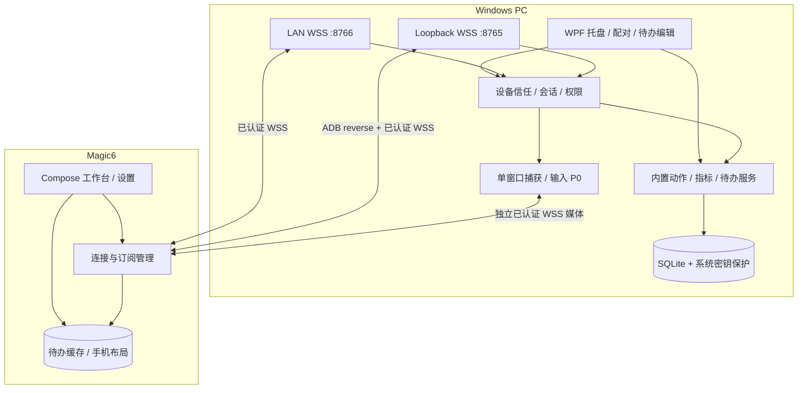
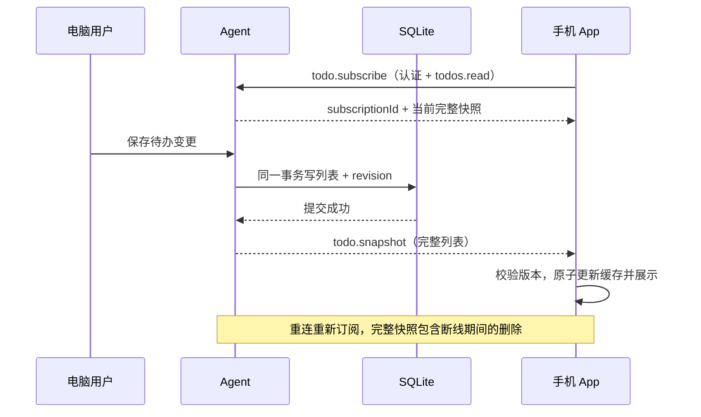

# 04｜总体技术架构

> 本篇保留早期设计及测试编号。当前产品范围以 [产品需求](01-产品需求PRD.md) 为准，协议及验收状态分别见 [实现协议](../PROTOCOL-IMPLEMENTED.md) 与 [验收记录](../VALIDATION.md)。

## 1. 双端结构



## 2. 职责与边界

- Windows：登录用户会话内托盘进程，WPF 与 Agent 首版同进程；普通用户权限。
- Android：扫码、连接、工作台、只读待办、缓存和手机本地布局。
- 内置模块注册动作；不引入动态加载机制。
- USB/LAN 各自认证；业务层使用统一消息、权限和请求 ID。
- 首版一台电脑、一台手机；每端只保留一个当前可信对端，不隐式替换。
- 待办写入只来自 PC 本地 UI；协议只提供已授权读取、订阅和快照事件。
- PC 是待办、动作配置与权限的权威来源；手机独立保存布局，二者不做双向配置同步。

## 3. 待办数据流



## 4. 核心接口

```text
ITransport.Connect/Send/Receive/Close
IConnectionManager.SelectLink/OnLinkChanged
ITrustStore.Get/Save/Revoke
ICommandHandler.CanExecute/Execute
ITelemetryProvider.Sample/Subscribe
ITodoService.ReadSnapshot/ApplyLocalChange/Subscribe
```

ApplyLocalChange 仅供 PC 本地 UI 调用，不映射远端修改 action。持久化提交后才发布快照；提交失败不报告保存成功。

### 已确认的实现分工

- UsbConnectionManager 负责 ADB 定位、指定设备状态与 reverse 映射，向 SessionManager 报告链路变化；认证和择路由会话层统一完成。
- CommandDispatcher 统一执行鉴权、参数校验、请求去重、动作分发及结果记录；各内置处理器只实现本领域行为。
- Android ViewModel 暴露连接、指标、待办等 StateFlow；一次性操作反馈走独立事件流，Compose 页面不直接持有 socket。
- TodoRepository 提供唯一已提交缓存数据源；订阅恢复和完整快照版本检查在数据/会话层完成，不由各页面重复发起。

以上采纳点及参考来源见文档 24。产品功能集合仍以 PRD v0.3 为准。

## 5. 部署与恢复

- USB 端点只监听 127.0.0.1；LAN 只监听选定私有网卡。
- 配对入口仅用户显式开启时有效，mDNS 不广播秘密或待办。
- USB 优先，LAN 热备；切换后恢复订阅，快照按 revision 去重。
- 请求超时不等于动作失败；有副作用动作先查询状态。
- 手机离线展示缓存；未同步过、已同步为空、离线及同步失败分别展示。

## 6. 已批准的功能扩展

P0 增加应用选择器、真实按钮状态、待办快捷录入与专注视图；P0 增加最近删除撤销、基本媒体操作和单应用窗口远程交互。

应用目录由 PC 解析与保存，手机取得允许项的稳定 ID/名称/iconId。音量状态独立订阅；“已收到”与“实际执行完成”分开，任务状态仍按 jobId 跟踪。

P0 WindowRegistry 负责允许应用到实际窗口的身份映射；WindowCaptureService 只捕获选定窗体，WindowInputRouter 管理当前控制会话、焦点与输入释放。媒体独立 WSS/socket 与有界队列，不经普通命令队列传帧。窗口模块的 stop/failure 不影响待办。

窗口捕获与操作详见文档 12；同一登录桌面的焦点/输入由 PC 和手机共享。
